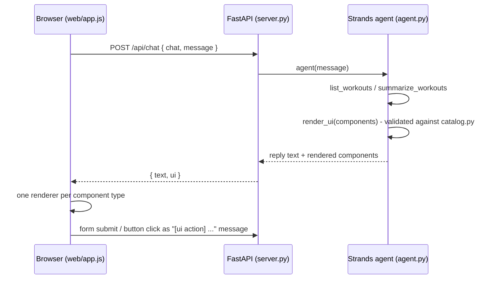

An agent that answers with UI, not just text. You ask a question, the agent picks components from a catalog the app defines (stats, charts, tables, forms, buttons), and the browser renders them. When someone submits a form or clicks a button, the interaction goes back to the agent, which acts on it and renders again.

The sample is a small workout log, but the pattern carries over to any app: define your components as a schema, give the agent a tool that takes that schema, and render what it sends.


## Overview

### Sample Details

| Information | Details |
| --- | --- |
| **Agent Architecture** | Single-agent |
| **Native Tools** | None |
| **Custom Tools** | `render_ui`, `list_workouts`, `summarize_workouts`, `log_workout` |
| **MCP Servers** | None |
| **Use Case Vertical** | Generative UI |
| **Complexity** | Basic |
| **Model Provider** | Amazon Bedrock |
| **SDK Used** | Strands Agents SDK, FastAPI |

### Architecture



### Key Features

-   **The schema is the contract.** `catalog.py` defines every component as a Pydantic model. Those models are the `render_ui` tool’s input, so the model can only produce components your app supports, and Strands validates them before your code sees them.
-   **The agent chooses the layout.** Different questions get different UI: totals become stat cards, trends become a bar chart, lists become a table, and “I want to log a workout” becomes a form.
-   **Interactive round trip.** Forms and buttons carry an `action` name. Interactions come back to the agent as a chat message, so it can log the workout and render an updated view.
-   **No frontend build.** The client is plain HTML and JavaScript. It renders with DOM APIs and text nodes only, so model output can’t inject markup.

## Prerequisites

-   Python 3.10+
-   AWS credentials configured, with [model access](https://docs.aws.amazon.com/bedrock/latest/userguide/model-access-modify.html) to the Strands default model on Amazon Bedrock (Claude Sonnet)

## Setup

```bash
python -m venv .venv
source .venv/bin/activate
pip install -r requirements.txt
```

## Usage

```bash
python server.py
```

Open [http://127.0.0.1:8000](http://127.0.0.1:8000). The server only listens on `127.0.0.1` and has no authentication, so it’s for local use. Set `PORT` to change the port.

## Example Queries

-   “How has my training been this month?” (stats, a weekly bar chart and a table)
-   “Show my runs from the last two weeks” (a table)
-   “I want to log a workout” (a form; submit it and the agent logs the workout and shows the updated totals)

## How It Works

**1\. Define the catalog** (`catalog.py`). Each component is a Pydantic model with a `type` literal, combined into a discriminated union. Field descriptions are written for the model, because they end up in the tool schema.

```python
class Stat(BaseModel):
    type: Literal["stat"]
    label: str
    value: str = Field(description="The headline number, formatted for display, e.g. '42 km'.")


Component = Annotated[Text | Stat | Table | BarChart | Form | Button | Row, Field(discriminator="type")]
```

**2\. Give the agent a `render_ui` tool** (`agent.py`). The tool’s only job is to collect validated components for the current turn.

```python
@tool
def render_ui(self, components: list[Component]) -> str:
    """Show UI components to the user, in order, below your reply."""
    self.ui.extend(components)
    return "Shown to the user. Now write your short reply."
```

**3\. Return the components with the reply.** `Chat.send()` runs the agent and returns `{"text": ..., "ui": [...]}`.

**4\. Render by type** (`web/app.js`). A lookup table maps each `type` to a function that builds DOM. Unknown types are skipped.

**5\. Send interactions back.** A form submit becomes a message like `[ui action] log_workout {"activity": "swim", "minutes": "40"}`, and the system prompt tells the agent how to handle it.

## Using This in Your Own App

-   Replace `catalog.py` with the components your design system already has, and keep the props small and display-ready (formatted strings rather than raw values the client has to format).
-   Write the renderer in your own frontend framework. A React version is the same lookup table with a component per `type`.
-   Do calculations in tools rather than letting the model do arithmetic. Here, `summarize_workouts` computes every total and the prompt tells the agent to use it.
-   To render while the model is still writing, switch from `agent(...)` to `agent.stream_async(...)` and forward the tool input as it streams.
-   Each chat keeps its agent in server memory and the workout log isn’t persisted, which keeps the sample short. A real app would add a [session manager](https://strandsagents.com/docs/user-guide/sdk/agents/session-management/) and a database.

## Project Structure

| File | Purpose |
| --- | --- |
| `catalog.py` | Component catalog (Pydantic models) |
| `agent.py` | System prompt, `render_ui` tool, and `Chat` wrapper |
| `tools.py` | Workout data tools |
| `server.py` | FastAPI app: `POST /api/chat` and static files |
| `web/` | Browser client and renderer |
| `data/workouts.json` | Sample workouts, with dates relative to today |

A TypeScript version of this sample lives in [`typescript/03-ux-demos/dynamic-ui`](https://github.com/strands-agents/samples/tree/c59f0c1e6ac0dd7e87729c8082e195074eec124b/typescript/03-ux-demos/dynamic-ui/) and uses the same web client.

## Additional Resources

-   [Custom tools](https://strandsagents.com/docs/user-guide/sdk/tools/custom-tools/): defining tools like `render_ui` with typed input schemas
-   [Streaming](https://strandsagents.com/docs/user-guide/sdk/streaming/): rendering components while the model is still writing
-   [Session management](https://strandsagents.com/docs/user-guide/sdk/agents/session-management/): persisting conversations across restarts
-   [AG-UI and CopilotKit sample](https://github.com/strands-agents/samples/tree/c59f0c1e6ac0dd7e87729c8082e195074eec124b/python/07-ux-demos/ag-ui-copilotkit-integration/): tool-based generative UI with a protocol and frontend framework

## Disclaimer

This sample is provided for educational and demonstration purposes only. It is not intended for production use without further development, testing, and hardening.

## Upstream source

- [View this sample at the imported commit](https://github.com/strands-agents/samples/tree/c59f0c1e6ac0dd7e87729c8082e195074eec124b/python/07-ux-demos/dynamic-ui)
