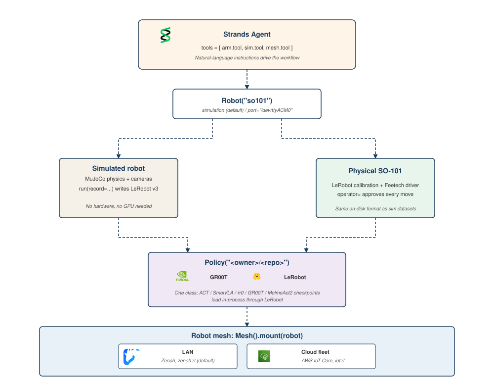
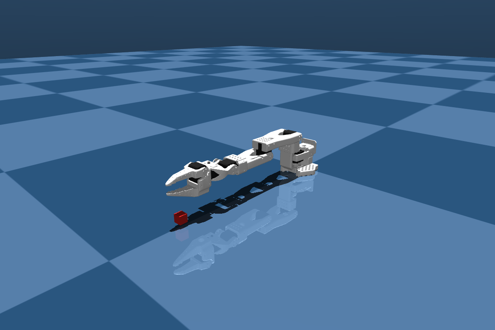
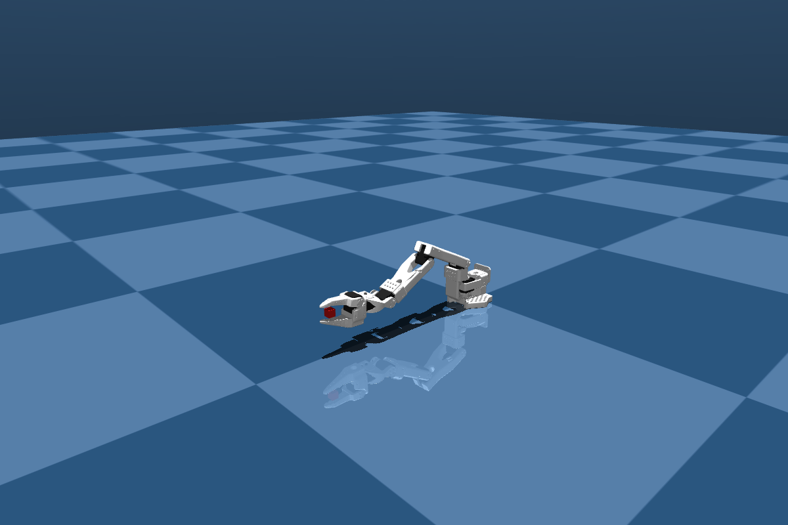
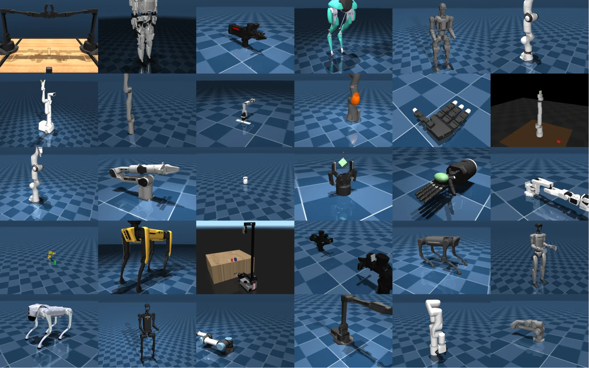

*Updated for Strands Robots 0.6, which rewrote the library around three classes: `Simulation`, `Robot` and `Policy`.*

You have a robot, a folder of demonstration data on the [Hugging Face Hub](https://huggingface.co), and a new task you want it to learn. Today that takes five separate tools: one to record new demonstrations, another to train, a third to test in simulation, custom code to deploy on hardware, and yet another to coordinate when you have more than one robot. The pieces work on their own. They don't talk to each other.

[Strands Robots](https://github.com/strands-labs/robots) is an open source SDK from AWS ([Apache 2.0](https://www.apache.org/licenses/LICENSE-2.0)) that gives you a robot, its simulation, and the [LeRobot](https://github.com/huggingface/lerobot) stack behind agent tools that you hand to a single Strands agent. The integration is deliberately thin: LeRobot's own scripts handle hardware recording and calibration, and Strands Robots comes in for the parts an agent actually orchestrates. A robot in simulation records LeRobotDatasets with LeRobot's own writer, in the same format LeRobot writes on hardware. A [`Policy`](https://strands-labs.github.io/robots/lerobot/) loads LeRobot checkpoints in-process behind one interface, including ACT, SmolVLA, pi0, [GR00T](https://github.com/NVIDIA/Isaac-GR00T) and MolmoAct2. A peer mesh fans the agent out to remote robots. The dataset format stays exactly as LeRobot wrote it; the agent loop is the glue.

This post walks you through five steps inside a single agent: build the agent over the robot's tools, record a demonstration as a LeRobotDataset in simulation, run a policy from the Hub on the same robot, deploy the same agent code to a physical [SO-101](https://github.com/TheRobotStudio/SO-ARM100) with one keyword argument change, and reach the robot over the [Zenoh](https://zenoh.io) mesh. At the end, you can clone the working sample from GitHub and run it on your laptop in simulation. No hardware, no GPU, no Hugging Face credentials needed for the default path. The runnable companion to this post is the notebook [`notebooks/11_hub_to_hardware.ipynb`](https://github.com/strands-labs/robots/blob/v0.6.0/notebooks/11_hub_to_hardware.ipynb).

## What you'll build

Strands Robots gives you the LeRobot stack behind agent tools that you hand to one Strands agent. The example agent in this post does four things: drive a simulated SO-101 while your code records a demonstration and pushes it to the Hub as a LeRobotDataset, run a policy from the Hub on that robot, and deploy the same agent code to a physical robot with one keyword argument change. When you have more than one robot, the agent can coordinate the whole fleet through a built-in peer mesh. For hardware recording and calibration, LeRobot's own CLIs (`lerobot-record`, `lerobot-calibrate`) handle the bring-up; the agent picks up from there.



*Figure 1. `Robot("so101")` is an SO-101 in a MuJoCo world by default; `Robot("so101", port=...)` drives the physical arm through the same safety chain. The agent holds the robot's tools, `run(record=...)` writes a LeRobot v3 dataset with LeRobot's own writer, and a `Policy` loads a checkpoint from the Hub by name, so a dataset captured in sim and a dataset captured on hardware use the same on-disk format.*

Two design choices make this work. First, [`Robot("so101")`](https://strands-labs.github.io/robots/robot/) is a robot in a simulated world by default (no hardware, no risk), and `Robot("so101", port=...)` is the same class driving a physical arm. The agent code is identical across both, and every command from the agent passes the robot's safety chain: a target outside a joint's range is refused, never clipped. Second, recording goes through LeRobot's own dataset writer on both the [simulation path](https://strands-labs.github.io/robots/simulation/) and hardware, so a dataset captured in [MuJoCo](https://mujoco.org) and one captured from a physical [SO-101](https://github.com/TheRobotStudio/SO-ARM100) are in the same format.

The whole workflow in five lines of Python:

```python
from strands import Agent
from strands_robots import Robot

arm = Robot("so101")              # an SO-101 in a MuJoCo world (no hardware)
agent = Agent(tools=[arm.tool])
agent("Raise the arm halfway, then tell me the joint positions")
```

What follows is what's actually happening inside that call, step by step.

## Prerequisites

### Minimal (default simulation path)

- Python 3.12, on Linux or macOS (Apple Silicon supported for the MuJoCo backend).
- A Strands-compatible model provider for the agent's reasoning. [Amazon Bedrock](https://aws.amazon.com/bedrock/) with AWS credentials, the [Anthropic API](https://docs.anthropic.com), OpenAI, or [Ollama](https://ollama.com) running locally.
- Strands Robots with the [install extras](https://strands-labs.github.io/robots/install/): `uv pip install "strands-robots[mujoco,lerobot,mesh,tools]>=0.6,<0.7"`. The `lerobot` extra installs LeRobot 0.7 from PyPI.

That's it. The example in this post runs end-to-end on a laptop with these three.

### Advanced (hardware deployment, real policies, Hub push)

- A Hugging Face account and token with write permission, for pushing datasets to the Hub (`hf auth login`).
- For the hardware path: an SO-101 follower and leader pair, or any other LeRobot-supported robot, and the `feetech` extra (`uv pip install "strands-robots[feetech]>=0.6,<0.7"`). Both devices need calibration files under `~/.cache/huggingface/lerobot/calibration/`.
- For larger checkpoints such as GR00T N1.7, SmolVLA or MolmoAct2: an NVIDIA GPU. They load in-process through LeRobot, so no container or Docker is needed.

## Step 1 - Set up the example

Install Strands Robots and get the example files:

```bash
uv pip install "strands-robots[mujoco,lerobot,mesh,tools]>=0.6,<0.7"
git clone --branch v0.6.0 https://github.com/strands-labs/robots.git
cd robots
```

Sign in to Hugging Face if you want to push datasets to the Hub. This is optional for the default simulation path in this post; the example runs end-to-end with a placeholder motion and writes the dataset to a local folder without needing Hub access.

```bash
hf auth login
```

The runnable example lives at `notebooks/11_hub_to_hardware.ipynb`, with the same code as a script in `notebooks/scripts/11_hub_to_hardware.py`, in the `strands-labs/robots` repository alongside the other numbered notebooks. The notebook is the recommended starting point: open it in [JupyterLab](https://jupyterlab.readthedocs.io) and run cells top-to-bottom in simulation without any hardware connected.

## Step 2 - Record demonstrations and push to the Hub

A robot in simulation [records LeRobotDatasets](https://strands-labs.github.io/robots/recording/) in the same format LeRobot writes on hardware. No hardware required. `robot.run(policy, record=...)` writes a LeRobot v3 dataset through LeRobot's own writer, one episode per run: same parquet schema for joint states and actions, same per-camera MP4 layout. Recording is an argument your code passes, not something the agent decides, so the operator chooses what is kept:

```python
import math
from strands_robots import Robot

arm = Robot("so101")  # an SO-101 in a MuJoCo world
arm.sim.add_object("red_cube", shape="box", size=[0.015] * 3, position=[0.0, -0.2, 0.015], color=[0.85, 0.1, 0.1, 1])
arm.sim.camera("front", position=(0.5, -0.6, 0.42), target=(-0.08, -0.05, 0.08), size=(320, 240), attach=arm)
arm.sim.camera("wrist", position=(0.0, 0.0, 0.05), target=(0.0, -0.1, -0.05), size=(640, 480), attach="so101/gripper")

def wave(obs):  # a placeholder motion, so the workflow runs before you have a trained policy
    return {"shoulder_pan": 0.6 * math.sin(3.0 * obs.t), "elbow_flex": 0.5 + 0.3 * math.sin(2.0 * obs.t)}

arm.run(wave, hz=30, seconds=3, record="hf://my_user/cube_picking_sim", push=True,
        instruction="pick up the red cube")
```

Pass a folder (`record="data/cube_picking_sim"`) instead to keep the dataset local.



*Figure 2. The recording scene in MuJoCo simulation: the SO-101 arm and a red cube on the ground plane, captured to a LeRobotDataset. No hardware, no GPU, no Hugging Face credentials needed for this default path.*

The placeholder motion is intentional: it moves the arm so the workflow runs end-to-end without a trained checkpoint. The robot waves rather than completing the grasp, and the recording is structurally complete (valid joint states, valid camera frames, a well-formed LeRobotDataset episode), but the demonstration itself isn't useful as training data. Step 3 below swaps in a trained policy from the Hub; the recording call, dataset format, and agent code stay the same.

The proof is what happens next. LeRobot's own dataset loader reads the sim-recorded data with no Strands-specific code path:

```python
from lerobot.datasets.lerobot_dataset import LeRobotDataset

dataset = LeRobotDataset("my_user/cube_picking_sim")
print(dataset.num_episodes, dataset.fps, list(dataset.features))
# 1 30 ['observation.state', 'action', 'time.measured', 'observation.images.front',
#       'observation.images.wrist', 'timestamp', 'frame_index', 'episode_index', 'index', 'task_index']
```

These features are the same as any LeRobot dataset on the Hub: same column names, same parquet+MP4 layout, same loader path, plus `time.measured`, the time each frame was actually read, so a stall shows up in the data. Training scripts that consume hardware-recorded data consume the sim-recorded data without modification. Datasets pushed from sim sit alongside hardware recordings in the same Hub repository if you want them to.

### Recording on hardware

To record demonstrations on a physical SO-101 instead of simulation, use LeRobot's record CLI directly. Strands Robots doesn't wrap that command because LeRobot already does the job cleanly:

```bash
lerobot-calibrate --robot.type=so101_follower --robot.id=my_follower
lerobot-calibrate --robot.type=so101_leader   --robot.id=my_leader

lerobot-record \
  --robot.type=so101_follower --robot.id=my_follower \
  --teleop.type=so101_leader  --teleop.id=my_leader \
  --dataset.repo_id=my_user/cube_picking \
  --dataset.single_task='Pick up the red cube and place it in the box' \
  --dataset.num_episodes=25 \
  --dataset.push_to_hub=true
```

The dataset that lands on the Hub from this command is in the same format as the simulation recording. To fine-tune a policy on it, run LeRobot's training CLI (`lerobot-train`); training itself is out of scope for this post and follows the standard LeRobot workflow. From Step 3 onward, the agent picks up either the original or a fine-tuned checkpoint interchangeably. For full SO-101 hardware setup, calibration, and cameras, see the [hardware guide](https://strands-labs.github.io/robots/hardware/).

## Step 3 - Run a policy in simulation

With the dataset on the Hub, the next step is to run a policy. A Hub repo id is a policy: `Policy("<owner>/<repo>")` loads a LeRobot checkpoint in-process with LeRobot's own loader. You hand it to the robot's tool by name, and the agent runs it the same way it would run any other policy:

```python
from strands import Agent
from strands_robots import Policy

act = Policy("robotfuel/act_so101_t16b", device="cpu", norm={"*": "degrees", "gripper": "range_0_100"})
agent = Agent(tools=[arm.tool(policies={"wave": wave, "act": act}), arm.sim.tool])

agent("Run the act policy for 3 seconds with the instruction 'pick up the red cube', "
      "then tell me in one sentence what the run reported.")
```

Under the hood, the agent calls the robot tool's `run` action with `policy="act"`. The robot steps the simulation with the policy's action chunks, and every action passes the same safety chain as a command from the agent. `norm=` states the units the checkpoint was trained in, and the library checks it against the checkpoint's saved statistics before the first step, naming the joint and the fix if they disagree. The chain applies to the policy too: in one of our runs it stopped the checkpoint after 1.3 seconds, when it asked for the gripper 0.0002 rad past its range, and the robot refused the step instead of clipping it. To run inference on a separate GPU machine instead, serve the checkpoint with LeRobot's `lerobot-policy-server` and point the robot at it with `Policy("zenoh://gpu-box:7447/<deployment>")`.



*Figure 3. The Hub ACT checkpoint driving the simulated SO-101. It was trained on a real SO-101 with a wrist camera, so here it moves the arm; a checkpoint trained on your own demonstrations swaps in by changing the string.*

A different checkpoint is a different string. `Policy` runs ACT, Diffusion, [SmolVLA](https://huggingface.co/blog/smolvla), [π0](https://www.pi.website/blog/pi0), [π0.5](https://www.pi.website/blog/pi05), GR00T and MolmoAct2 checkpoints, anything LeRobot's own policy registry can load. The [policy guide](https://strands-labs.github.io/robots/lerobot/) lists the families and the options.

*Note: Loading a checkpoint runs code its publisher chose. A `Policy` your own code builds loads directly; a Hub checkpoint the agent asks for by name loads only if the operator lists it in* `STRANDS_POLICY_REPOS` *(for example* `STRANDS_POLICY_REPOS=lerobot/smolvla_base,my_user/*`*). Only load checkpoints from organizations you trust.*

## Step 4 - Deploy the policy to physical hardware

This is the same code as Step 3, with one keyword argument changed. `port=` gives the same `Robot` class a Feetech driver for the physical arm, with LeRobot's calibration file:

```python
arm = Robot(
    "so101",
    port="/dev/ttyACM0",
    id="my_follower",                      # the LeRobot calibration file to load
    cameras={"wrist": {"index": 0, "width": 640, "height": 480, "fps": 30}},
    operator=lambda request: input(f"{request}? [y/N] ") == "y",
)
agent = Agent(tools=[arm.tool(policies={"act": act})])

agent("Run the act policy for 10 seconds with the instruction 'pick up the red cube'.")
```

The same agent prompt now runs against a physical arm. The camera names are the image keys the policy sees, and on a real arm nothing moves without the operator: `operator=` is asked once for every move a tool requests, and once for a policy run's plan. The same checkpoint, loaded in-process, generates the action chunks.

Before this runs against your SO-101, calibration for both follower and leader has to be in place. Run LeRobot's calibration command (`lerobot-calibrate`) once per device; the files land under ~/.cache/huggingface/lerobot/calibration/ and `Robot(..., id=...)` reads them from there. If a calibration is missing, the robot says which file it looked for.

## Step 5 - Coordinate multiple robots with the mesh

Up to now we've driven one robot at a time. [The mesh](https://strands-labs.github.io/robots/mesh/) is how Strands Robots handles more than one. Picture five SO-101s running the same warehouse task in parallel, a humanoid coordinating with a mobile base, or an arm in another room that an agent on your laptop drives. All of those are mesh patterns. The mesh is built on Zenoh, an open source peer-to-peer protocol, and you don't manage IP addresses, write discovery code, or pick a broker; robots show up on the mesh the moment they're mounted, and the agent can talk to all of them at once.

A robot joins a mesh when you mount it, and the agent reaches every robot on the mesh through one tool, `use_mesh`:

```python
from strands import Agent
from strands_robots.mesh import Mesh

bench = Mesh("zenoh://", tenant="lab")      # where the robot runs
bench.mount(arm, labels={"role": "arm"})     # the simulated arm from Steps 2-3; a real arm needs mesh certificates (see below)

me = Mesh("zenoh://", tenant="lab")          # where the agent runs, on any machine on the LAN
agent = Agent(tools=[me.tool])
agent("List every arm on the mesh, then send each one to its home pose (every joint at 0 rad) over one second.")
```

The agent lists the devices on the mesh, reads each one's manifest, and invokes the same actions the robot's own tool has: `observe`, `act`, `run`, `stop` and `estop`. Use `Mesh("iot://us-west-2")` with the `iot` extra to route the same calls over AWS IoT Core for cross-network fleets; the agent code doesn't change.

Safety goes with the robot, not the transport. An agent can always press e-stop, on one robot or with a broadcast to all of them, but it can never resume one: only a named operator can, with `resume(approved_by=...)`. A plain `zenoh://` mesh is one any machine on the network can join, so a real robot on it is observe-only until you give the lab certificates (`python -m strands_robots.mesh ca` and `cert`); simulated robots take commands on it freely.

The transport scales without touching agent code. On the LAN, Zenoh peers find each other with no broker. Across subnets, run a `zenohd` router with its own certificate, and for cloud fleets the `iot://` mesh carries the same calls over [AWS IoT Core](https://aws.amazon.com/iot-core/) with an X.509 certificate per robot.

## Try it using the sample application

The full sample is on GitHub at [strands-labs/robots](https://github.com/strands-labs/robots) in the `notebooks/` folder. Notebook 11 packages all five steps, with the same code as a script in `notebooks/scripts/11_hub_to_hardware.py`. It runs in simulation with a placeholder motion and a small ACT checkpoint from the Hub. No GPU, no Docker, no Hugging Face credentials needed.

```bash
uv pip install "strands-robots[mujoco,lerobot,mesh,tools]>=0.6,<0.7" jupyter
git clone --branch v0.6.0 https://github.com/strands-labs/robots.git
cd robots

jupyter notebook notebooks/11_hub_to_hardware.ipynb
```

The agent steps use Amazon Bedrock with your AWS credentials; set `STRANDS_MODEL_ID` to the model you want. The recorded dataset lands in a temporary folder the notebook prints. To push it to the Hugging Face Hub instead of keeping it local, set `HF_USER=<your-user>` after `hf auth login` with write scope.

## Security considerations

The code snippets shown in this setup represent a “hello world” example of setting up Strands Robots with HuggingFace. For more serious, production-ready use cases there are some important considerations users should be aware of:

### Prompt injection

Supplying untrusted data into agents can lead to prompt injection, where untrustworthy context is treated as LLM instructions. Given the actuation of these robots in physical space, this is an important risk to track. To mitigate this behavior, developers should be careful to feed the robots only data that comes from a trusted source. If not all input data can be trusted, developers should restrict the tools available to the agent to prevent the robots from making safety-critical actions.

### Robot mesh auth behavior

A plain `zenoh://` mesh, as in the snippets in this post, has no access control: any device on the same network can join it, and the peer id in a request is only a claim. That is why a real robot on it answers only `describe`, `observe`, `stop` and `estop`. For untrusted networks or production environments, give each machine a lab certificate (`python -m strands_robots.mesh ca`, then `cert`), so the mesh runs over mutual TLS and only machines with a certificate can reach a robot. On AWS IoT Core, give each robot its own X.509 certificate and an IoT policy limited to its own topics.

### Operator approval for physical actions

On a real robot, `operator=` is the gate: one function answers every move a tool, the dashboard or the mesh asks for, and every policy run's plan, once, before anything moves. The agent's approval never comes from its own tool arguments, so a prompt-injection attempt that slips an approval into a command cannot bypass it. An agent can always press e-stop but can never release one, calibrate, record, push, or choose a policy address on the network, and it loads a Hub checkpoint by name only if the operator lists it in `STRANDS_POLICY_REPOS`.

## Clean up

The preceding workflow opens serial ports on hardware and writes a local dataset cache. To return your environment to a clean state:

- **Release the serial ports:** if you ran the hardware path, call `arm.close()` (it holds the arm with torque on, so a loaded arm doesn't drop), then disconnect the SO-101 follower and leader.
- **Optionally remove the local datasets:** the recorded dataset lives in the folder you passed to `record=`, and Hub downloads under `~/.cache/huggingface/`. Datasets you pushed to the Hub are unaffected.

## How this fits together

The integration's central design choice is that Strands Robots doesn't reimplement what LeRobot already provides. Calibration, the dataset format, and the policies stay upstream. Strands adds the agent tools, the safety chain and the mesh that make them composable from natural language.

Two consequences follow. For users, every dataset on the Hub is an asset an agent can extend, fine-tune from, and deploy against with no conversion step. For developers, simulation data and hardware data share a single file format, so training scripts written for one consume the other unchanged. The line between sim and real becomes a deployment detail, not an architectural divide.

## Where to go from here



*Figure 4. The Strands Robots catalog spans arms, humanoids, mobile bases, and hands, all in the same MuJoCo simulation and behind the same `Robot` class. The SO-101 in this post is one of its 76 robot presets.*

The full [Strands Robots documentation](https://strands-labs.github.io/robots/) covers the [robot catalog](https://strands-labs.github.io/robots/robots/), simulation, policies, recording, and the mesh in depth. For larger workloads, Strands Robots also runs GPU simulation: MuJoCo-Warp with `Simulation("mujoco", physics="newton")` and Isaac Sim with `Simulation("isaac")`. Both sit behind the same `Robot` class shown in this post, so the agent code stays the same as you scale up.

Contributions are welcome under Apache 2.0. If you build something with this workflow, open an issue with what worked and what didn't. The SDK improves fastest when developer feedback lands directly on the surface that needs it.

## Resources

- **Strands Robots** (SDK, agent tools, `Robot`, `Simulation`, `Policy`): [github.com/strands-labs/robots](https://github.com/strands-labs/robots), Apache 2.0
- **Strands Robots docs** (full documentation): [strands-labs.github.io/robots](https://strands-labs.github.io/robots/)
- **The example:** [notebooks/11_hub_to_hardware.ipynb](https://github.com/strands-labs/robots/blob/v0.6.0/notebooks/11_hub_to_hardware.ipynb) and [the script](https://github.com/strands-labs/robots/blob/v0.6.0/notebooks/scripts/11_hub_to_hardware.py)
- **How to Build Physical AI Agents: Natural Language for Real-World Robotics**: [Live Stream](https://www.youtube.com/watch?v=K5fVWNeaqiM) and [Blog](https://aws.amazon.com/blogs/opensource/building-intelligent-physical-ai-from-edge-to-cloud-with-strands-agents-bedrock-agentcore-claude-4-5-nvidia-gr00t-and-hugging-face-lerobot/)
- **Diving Deep on Physical AI | S1E4 | Automate with NVIDIA NeMo Agent Toolkit and Bedrock AgentCore**: [Live Stream](https://www.youtube.com/watch?v=o4WJrv4jlCU)
- **LeRobot**: [github.com/huggingface/lerobot](https://github.com/huggingface/lerobot) - datasets, policies, hardware drivers
- **Strands Agents SDK**: [github.com/strands-agents/harness-sdk](https://github.com/strands-agents/harness-sdk)
- **SmolVLA**: [SmolVLA](https://huggingface.co/lerobot/smolvla_base)
- **Pi0**: [Pi0](https://huggingface.co/lerobot/pi0_base)
- **NVIDIA Isaac-GR00T N1.7**: [GR00T N1.7](https://huggingface.co/nvidia/GR00T-N1.7-3B)
- **The ACT checkpoint used in Step 3**: [robotfuel/act_so101_t16b](https://huggingface.co/robotfuel/act_so101_t16b)

