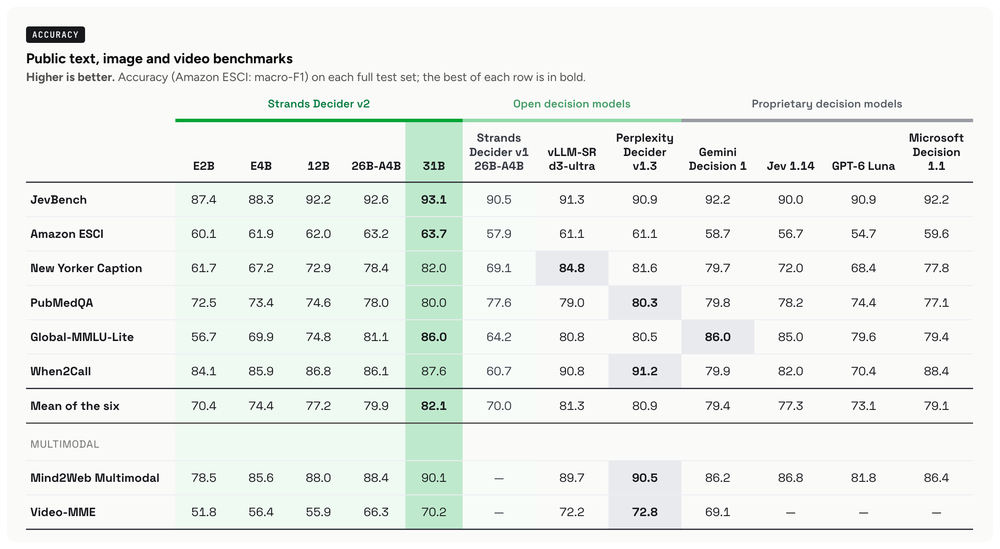
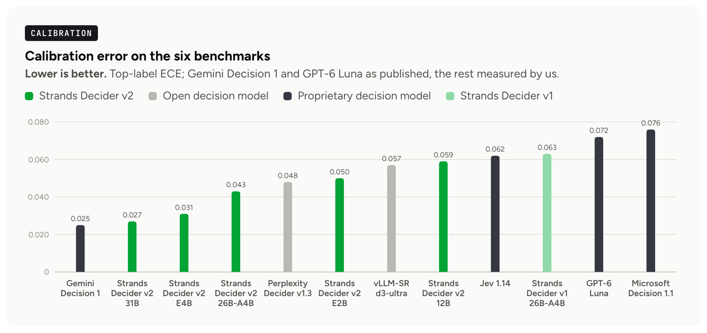
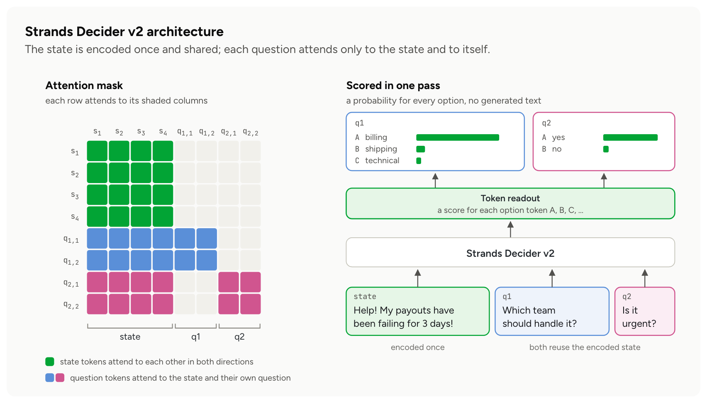
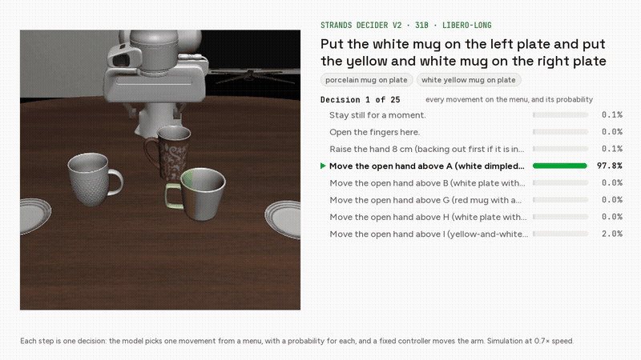

Today, we're releasing Strands Decider v2: five system one models built on Gemma 4, from E2B to 31B, under Apache-2.0. The weights are on [Hugging Face](https://huggingface.co/StrandsAgents), and v2 support is in the open-source [Strands Decider repository](https://github.com/strands-labs/strands-decider).

Decider is a system one model. Instead of generating text, the model picks from a list of options you give it and returns a probability for each in a single forward pass. This unlocks many small decisions and judgments that can run in an agent: which tool to call, where to route a request, whether an answer is good enough.

We've already seen Strands Decider do an LLM's job at a fraction of the inference cost. Using v1, engineers on one of Amazon's largest internal ticketing systems [replaced Claude Sonnet 4.6 with Decider](/blog/amazon-saves-millions-replacing-sonnet-with-strands-decider/) for ticket labeling, cutting cost by 98% and making each call 78% faster. The community has put it to work on model routing, tool selection, guardrails, and even classifying browser tabs locally with WebGPU.

With v2, we expect to go further. A new architecture and 17.5 million training examples bring higher accuracy across a broad range of decision tasks, better-calibrated confidence scores, and training tailored to long inputs such as agent traces.

Here is a decision in one command, after `pip install strands-decider`:

```bash
strands-decider ask StrandsAgents/strands-decider-E4B-gemma4-v2-2611 \
  --state "Help! My payouts have been failing for 3 days!" \
  --choice "Which team should handle this?=billing,sales,retail"
```

You get back a probability for each team. No text generation, no parsing.



_Figure 1: Strands Decider v2 performance._

## How does it perform?

On six public text benchmarks, Strands Decider v2 31B averages 82.1, up from 70.0 for Strands Decider v1 26B-A4B. It also scores 90.1 on image tasks and 70.2 on video tasks, extending its decisions beyond text. The gains carry through to smaller models: v2 E4B raises the six-benchmark average from 62.7 to 74.4 over v1.

Decider v2 is also better calibrated: its probabilities more closely match how often it is right. On the same six benchmarks, v2 31B has an expected calibration error (ECE) of 0.027, down from 0.062 for v1 26B-A4B (Figure 2). Lower calibration error makes confidence scores useful for deciding when an agent should act, call a larger model, or ask a human.



_Figure 2: Calibration error on the six text benchmarks; lower is better._

## What changed under the hood?

|                   | Strands Decider v1                                    | Strands Decider v2                                      |
| ----------------- | ----------------------------------------------------- | ------------------------------------------------------- |
| **Bases**         | Qwen3.5-2B; Gemma 4 E2B to 26B-A4B                    | Gemma 4 E2B, E4B, 12B, 26B-A4B, and 31B                 |
| **Readout**       | Added pointer head                                    | Direct scoring of option tokens                         |
| **Attention**     | Causal                                                | Prefix-bidirectional                                    |
| **Prompt**        | Plain text; numbered options                          | strands-chat, option tokens such as A, B, C, etc.       |
| **LoRA**          | Rank 16                                               | Rank 64 (α 128), and every routed expert of the 26B-A4B |
| **Training data** | 136k examples                                         | 17M examples                                            |
| **Objective**     | Cross-entropy with distillation and KL regularization | Answer-only cross-entropy                               |

**Direct scoring of option tokens.** v1 used an added pointer head to select an answer. v2 replaces the LM head with a token readout: a 255-row layer that starts from the LM head's rows for the option tokens A, B, C, and so on, and is trained with the model; the rest of the LM head is dropped. Each option's probability is read from its token at the end of the prompt.

**Shared context with prefix-bidirectional attention.** v2 encodes the shared state once, with attention in both directions. Each question attends to that state without re-encoding it, so additional questions require processing only their own tokens, as shown in Figure 3.



_Figure 3: The Strands Decider v2 architecture._

**Why this matters in agent loops.** Most LLMs use causal attention because they generate text one token at a time. A decision model never generates. It is all prefill: it reads the state, question, and options in one pass, then scores the options. That frees us to let tokens attend in both directions, so a detail at the start of a long agent trace is read in light of the question that comes after it. And because the work is a single forward pass, decisions are fast. For a deeper look, Jonathan Buck explains how the team uses bidirectional attention in [this episode of The Strands Decider Podcast](https://www.youtube.com/watch?v=dIt_CFbBwjU).

**A larger, simpler training recipe.** Each size starts from its corresponding Gemma 4 instruction-tuned model and trains for one epoch on 17.48 million decision examples: openly licensed human-labeled datasets, synthetic examples generated from task descriptions rather than benchmark items, and problems with programmatically computed answers. We use rank-64 LoRA, adapting every routed expert in the 26B-A4B model, and train with cross-entropy on the answer only. For each size, we average the weights of three runs with different random seeds, then fit a calibration temperature on held-out questions and include it in the released checkpoint.

## What can you build with it?

Decider fits the decisions inside an agent loop that have a known set of answers: which model or tool to use, whether a tool call's arguments look right, whether an answer is grounded or safe, and which team should own a request. If you build with the [Strands Harness SDK](/), you can place Decider directly in your agent. The [Strands Decider docs](/docs/labs/strands-decider/overview/) cover the question types and when to use them, and the repo's [Strands agent example](https://github.com/strands-labs/strands-decider/tree/main/examples/strands) gates a tool call with a `before_tool_call` intervention, so the agent asks which city you mean instead of guessing.

Calibration makes a simple pattern work: let a small model do the job, and call a large one only when Decider doesn't trust the answer. On AutoMix's reading-comprehension benchmarks, we sent the half of Llama-2-13B's answers that v2 trusted least to Llama-2-70B. That recovered 94% to 99% of the larger model's gain. A random half recovered 50%.

The same idea works before the small model acts. Used as a router without fine-tuning, Decider split requests between Claude Haiku 5.5 and Sonnet 5.5 on a mix of customer-service and app-automation tasks. It solved 94% as many tasks as Sonnet alone at 44% of the cost, 11.7 more tasks per 100 than a random split at the same cost. On LLMRouterBench, routing between DeepSeek V3 and Gemini 2.5 Pro reached 88% of Gemini 2.5 Pro's accuracy at 18% of its cost, matching the best open-source router we tested.

### Use cases

We've seen Strands Decider save Amazon's ticketing team millions by replacing Sonnet 4.6. The model also powers custom evaluators in [Amazon Bedrock AgentCore Evaluations](https://docs.aws.amazon.com/bedrock-agentcore/latest/devguide/evaluators.html), where Decider screens every interaction for unsupported claims and passes a case to an LLM evaluator only when it flags a claim or is uncertain.

A surprising use case was watching Decider operate a robot. In the simulation below, v2 steers a robot arm by picking its next movement from a short menu at each step, while a fixed controller moves the arm.



_Figure 4: Strands Decider v2 31B on LIBERO-Long: it puts the white mug on the left plate and the yellow-and-white mug on the right plate, in 25 decisions. The bars are its probability for every movement on the menu._

## How do I run it?

Use `ask` for one-off decisions, as shown above. For anything more, serve a model and send it HTTP requests. The state is read once, and each extra question adds only its own tokens:

```bash
strands-decider serve StrandsAgents/strands-decider-E4B-gemma4-v2-2611 --port 8000
```

```bash
curl -s localhost:8000/v1/systemone \
  -H 'content-type: application/json' \
  -d '{
    "state": "Help! My payouts have been failing for 3 days!",
    "questions": {
      "is_urgent": {"type": "noul", "instructions": "Does this convey urgency?"}
    }
  }'
```

The server you run locally is the same server you deploy. The repo's [deploy guide](https://github.com/strands-labs/strands-decider/tree/main/deploy) lists where it can run, with instructions for each: on your own machine with CUDA, on a Mac, or on CPU; on a real-time [Amazon SageMaker AI endpoint](https://github.com/strands-labs/strands-decider/tree/main/deploy/sagemaker), created and removed with one CDK stack; or on [AWS Lambda](https://github.com/strands-labs/strands-decider/tree/main/deploy/lambda), where the repo's stack runs a quantized model on arm64 CPUs, with nothing running between requests. SageMaker is how the ticketing team runs Decider in production.

v2 also runs in llama.cpp and MLX, thanks to fixes we contributed upstream for Gemma 4 checkpoints. We appreciate the maintainers who reviewed them.

## What's next

Most of what an agent does is decide: which tool, which model, whether to trust an answer. v2 makes those decisions fast enough to run on every step, and honest enough about its confidence that you can act on it.

This is Strands Labs, so it's early, and it's open. The weights are on [Hugging Face](https://huggingface.co/StrandsAgents), and the code, training recipe, and evaluations are on [GitHub](https://github.com/strands-labs/strands-decider). Try v2 on one real decision in your agent, then open an issue, send a pull request, or share your task and results in the [Strands Discord](https://discord.com/invite/strands). What you tell us decides what we train next.

We can't wait to see what you 'decide' to build.
