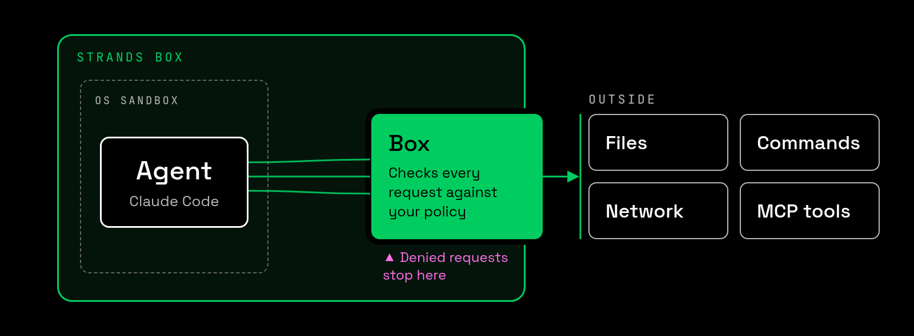
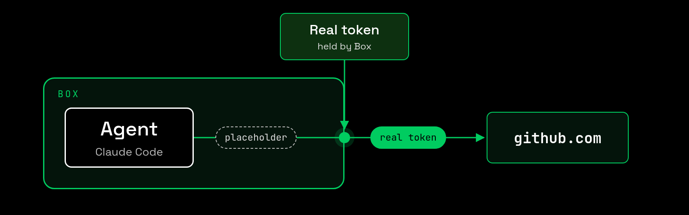
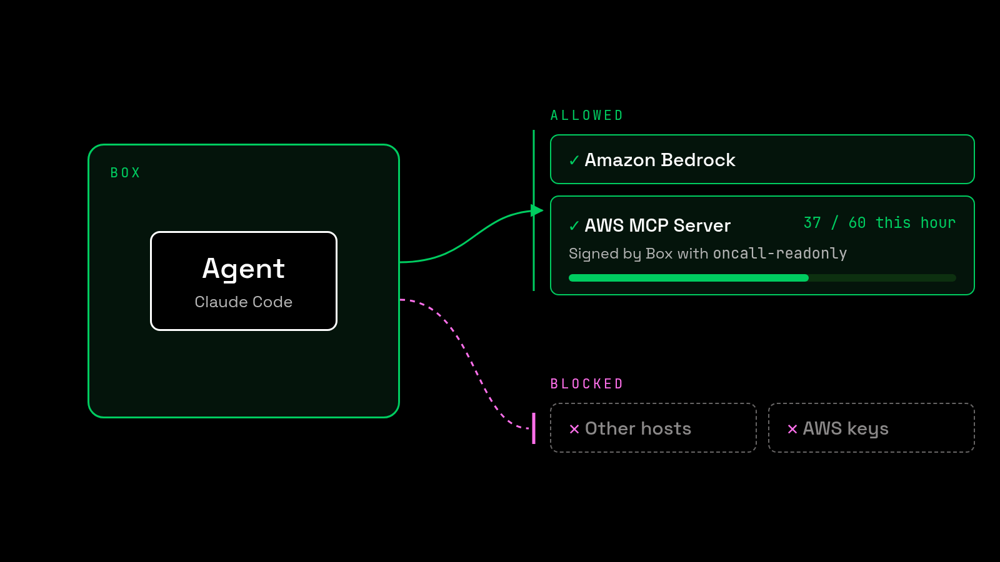

import policyChangeGif from './resources/strands-box-cli/policy-change.gif'

Developers are increasingly running coding agents in "YOLO mode": no permission or security prompts and no review of each command. The agent keeps working while you work on other tasks. For a lot of teams, that's how an agent gets work done.

It also means the agent can reach everything you can. We've all seen the stories of agents leaking credentials or deleting things they shouldn't. Models keep getting better, but a model's good intentions aren't reliable enough to stake a production database on. An agent can also be tricked: a README or web page it reads can tell it to do something you never asked for.

So most developers end up choosing between two options. They run the agent in YOLO mode and hope it stays out of trouble, or they go back to approving each step by hand whenever a session gets near production hosts or credentials. If you're paged at 3 AM and then have to approve each tool call, the agent isn't saving you much time.

What we want is to run the agent in YOLO mode inside a sandbox, where it works freely but can only reach what we allow and never sees our credentials. The right limits depend on the task: an agent writing code in one project needs different access than an agent investigating an outage in your AWS account. So we set those limits once for each kind of task, and the sandbox enforces them on every request.

## One command to put your agent in a box

In October we released [Strands Box](https://aws.amazon.com/blogs/opensource/introducing-strands-box-ai-agent-sandboxes-powered-by-dogwood/), an open source sandbox that contains an agent on your machine and checks what it does against a policy.

Today, we're adding native support for Claude Code, Codex, and Kiro CLI to Strands Box. You can start a sandboxed agent session in one command, using the agent and tools already installed on your machine:

```sh
cd ~/src/my-app
box run claude
```

The first time you run it, `box` asks a few questions and writes a profile that runs your agent. After that, the same command starts the agent in a box.

It's still Claude Code but inside of the box, and you use it the way you always have. Box sits underneath and stays out of the way until the agent reaches for something it shouldn't. Codex, Kiro CLI, and pi work the same way.

## How Box works

Box runs the agent inside an operating system sandbox, so the agent can only reach the files its profile allows. Everything else the agent does goes through Box: every shell command and the files it touches, every network request, and every MCP call.

Box checks each of those requests against your policy. It understands what a request means, so a rule can name a file, a command, a host, or a tool. The check happens outside the model, so nothing the agent reads or decides can change the answer. The agent can't change its own policy or write code to get around it.



### Rules in Dogwood

Box's rules are written in [Dogwood](https://github.com/dogwood-policy/dogwood). Each rule is about something the agent actually does, like reading a file, running a command, sending a request to a host, or calling an MCP tool. So you can be specific: in the coding profile below, the agent can read `~/.shared` but not the secrets folder inside it.

Rules can also look back at what the agent already did in the session. The on-call profile uses that to cap how many AWS calls the agent makes in an hour, which a plain allow or deny can't do.

Marc Brooker's post, [Strands Box: The Big Picture](/blog/strands-box-the-big-picture/), goes deeper on why we built it this way.

## Profiles and packs

Several things have to come together to run an agent in a Strands Box. To run Claude Code inside a sandbox, Box needs to configure the process and its settings, and set up a route to its model with your key attached. Box CLI has two built-in layers that do that work for you: profiles and packs.

A **pack** holds what one program needs in a box: the agent itself, a model provider, or a tool. It says how to start the program and what that program needs to run. For example, the `box/bedrock` pack sends the agent's model requests to Amazon Bedrock and adds your API key on the way out. The CLI ships packs for agents (Claude Code, Codex, Kiro CLI, pi), for model providers (Amazon Bedrock, Anthropic), and for everyday tools (git, gh, npm, uv, cargo).

A **profile** puts packs together into one agent persona. It names the packs, the policy files, and your own settings:

```toml
packs = ["box/claude", "box/bedrock", "box/git", "box/npm"]
policies = ["policy.dw"]
```

## Credentials stay outside the box

An agent needs keys to do work: an API key for its model, a token to push to GitHub, or AWS credentials to look at an account. Strands Box keeps credentials outside the box so that the agent never sees them; instead the agent sees a placeholder, and Box's egress gateway swaps in the real key as the request leaves. Since the agent never holds the key, it can't leak it.

The `box/bedrock` pack already does this for your model key. For anything else, you add a route to the profile. The coding agent below pushes to GitHub with this one:

```toml
[egress.github]
destinations = ["github.com"]
secret.ref = "env://GIT_GITHUB"
secret.placement = "basic_auth"
secret.inject = "always"
```

We export `GIT_GITHUB` as `x-access-token:<token>` before `box run`. Inside the box the variable is a placeholder. When a request to `github.com` leaves the box, the egress gateway puts the real token in its place, so the agent never sees it.



A route can also get its key from an AWS profile. With `aws://<profile>`, Box signs each request with that profile's credentials, which is what the on-call agent below does.

## Two personas means two profiles

You can keep as many profiles as you like and pick one each time with `box run <profile>`. Each one starts from a policy you pick when you create it, and you add your own rules on top.

Here are two example profiles we use, `coding` and `oncall`. In both, we turn off Claude Code's permission prompts with `agent.skip-permissions = "true"` under `[options]` in `profile.toml`, because the box decides instead.

We didn't write the policies in this post by hand, and we don't expect you to either. Box is built so an agent can write policy for you, and every profile comes with a guide for coding agents. We describe the rule we want to a regular agent outside the box, read what it writes, and check it with `box profile show`.

### A coding agent

This one writes code in a single project. It can read and change that project, run git and npm, reach the model and the npm registry, and push to GitHub with the route above:

```sh
box profile create coding --with claude,bedrock --tools git,npm --policy scoped
box run coding
```

We also know that sometimes you need to adjust policy as you're working. For example, say a coding agent needs a folder of shared notes outside the project, `~/.shared`. The box refuses the read at first because no rule allows it, and the activity banner, the status line `box` shows below the agent, shows the denial.

As you're running, ask Claude Code in another terminal, outside the box, to open the folder for reading but keep the credentials in `~/.shared/.secrets` closed. It adds two rules:

```text
@id("shared_read")
permit (principal, action == Box::Action::"fs:read", resource)
when { context.input.path == "~/.shared" || context.input.path like "~/.shared/*" };

@id("shared_secrets")
@description("~/.shared/.secrets holds credentials. Ask the user for what you need instead.")
forbid (principal, action == Box::Action::"fs:read", resource)
when { context.input.path == "~/.shared/.secrets" || context.input.path like "~/.shared/.secrets/*" };
```

But you don't have to restart the session. Box CLI checks the edit, the banner shows that an update is ready, and one keypress applies it while the agent keeps running. In the same session, the agent can now read the notes, but not the folder inside them:

{/* Imported and rendered with  so the GIF stays animated (Markdown images are converted to static WebP). */}


When a rule denies a request, Box returns the rule's description to the agent as the reason, so the agent can react instead of blindly retrying.

### An on-call agent

Now let's look at a profile that helps an on-call engineer at 3 AM. This agent doesn't need to write code. It looks at what's happening in an AWS account and reports what it finds.

It can make requests to the model and the AWS MCP Server but nothing else on the network. Its route to the AWS MCP Server uses `aws://`, so it never has direct access to AWS keys. The parts of its `profile.toml` that matter here:

```toml
packs = ["box/claude", "box/bedrock"]
policies = ["policy.dw", "oncall.dw"]

# The box signs each request to the AWS MCP Server with the oncall-readonly AWS profile.
[mcp.aws]
type = "http"
destinations = ["aws-mcp.us-east-1.api.aws"]
secret.ref = "aws://oncall-readonly"
```



The rate limit, in `oncall.dw`, is a rule that depends on history. An agent that can't find the root cause of an outage can keep investigating, calling the same tools over and over, and burning tokens and API calls while you're half asleep. This rule counts the tool calls that finished in the last hour and refuses the 61st, and its message tells the agent to report what it found so far:

```text
@id("aws_mcp_rate_limit")
@description("At most 60 AWS MCP calls an hour. Tell the user what you found so far.")
forbid (principal, action == Box::Action::"mcp:call", resource)
when { context.input.server == "aws" && context.input.method == "tools/call" }
when temporal {
  exists (total: Long). (
    (count for (t: Timepoint). where (
      formerly within 1h (
        Box::Action::"mcp:call"::response{ input.server: "aws", input.method: "tools/call" } && tp(t)
      )
    )) == total && total >= 60
  )
};
```

Both profiles run Claude Code, but they let the agent do very different things. Each one also keeps its own storage, so the on-call agent's sessions and memory never show up in the coding agent's box, and the other way around. We run both in YOLO mode, the on-call one included, because the boundaries are set ahead of time and the agent can't get around them.

A profile that only reads data and makes no changing API calls works well for an operations agent, but for everyday work you'll often want a looser profile and policy as your daily driver. The Box CLI lets you choose, whichever agent you're using.

## Try it

Box CLI is in preview and runs on Apple silicon Macs with macOS 15 or later, and on Linux ARM64 and x86-64 ([requirements](https://github.com/strands-agents/box/blob/main/docs/cli/install.md#requirements)). Install it with:

```sh
curl -fsSL https://raw.githubusercontent.com/strands-agents/box/main/install.sh | BOX_VERSION=0.3.0-preview.1 sh
```

Then run your agent from a project:

```sh
cd ~/src/my-app
box run claude
```

[Get started](https://github.com/strands-agents/box/blob/main/docs/cli/getting-started.md) walks through the first run, including connecting to Amazon Bedrock.

The profiles and policies in this post are in **TODO: example repo**, which is the easiest place to start. Begin with the coding profile, have the agent read a file in `~/.shared/.secrets`, and watch the box refuse it. Then change a rule to fit how you work.

If something doesn't work the way you expect, or you want a pack for a tool we don't have yet, [open an issue](https://github.com/strands-agents/box/issues).
