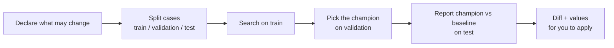

Optimization answers **"what should I change about my agent to do its task better?"** You
declare what may change (the system prompt, a tool description, a skill, the
context manager, the model, a temperature) and provide an [experiment](../how-evaluation-works.md#what-an-evaluation-is-made-of) that measures
how well the agent does its task: one you already have, or a new one built for this.

The optimizer then builds versions of your agent, each with a different mix of the
allowed changes. It runs every version on the experiment's cases, scores it with the
experiment's evaluators, and returns the best version it found: a diff for any text it
rewrote, and the new values for everything else, such as a model or a temperature.

It never edits your code. You review the result and apply it yourself. The optimizer
lives in `strands_evals.optimization` and needs the `optimization` extra:
`pip install 'strands-agents-evals[optimization]'`.

## Let your coding assistant set it up

If you'd rather not write the run by hand, the evals SDK ships an `optimize`
[agent skill](https://agentskills.io) that guides the coding assistant you already use
(Claude Code, Kiro, or any assistant that reads skills) through it. The skill works with
agents built with the Strands harness, from an `agent.py` or `agent.ts` file, and with
Python tunable factories. It asks what
may change, what "better" means, any limits, and how much to spend, all in plain language.
It then shows you the exact command to review, runs it with progress, and reports what
won. It never applies the result unless you ask.

### Install the skills

<CopyPromptButton language="evals-skills" />

To install them yourself instead: the skills ship inside the `strands-agents-evals` package.
Install them into your coding assistant with the
[`skills` CLI](https://github.com/vercel-labs/skills), run from the environment where you
installed the package:

```bash
npx skills add "$(python -c 'import strands_evals, pathlib; print(pathlib.Path(strands_evals.__file__).parent / ".agents" / "skills")')" --copy
```

`--copy` copies the skills into your project, so they keep working if that environment is
deleted. Run the command again after you upgrade `strands-agents-evals`. To install only
some of them, add `-s <name>`; to pick an assistant, add `-a claude-code`; to install for
every project, add `-g`.

## Why optimize instead of tweaking by hand?

Hand tuning works until there are more than two knobs. Then every change needs a full eval
run, one lucky run looks like a win, and nobody remembers which combination was tried.

**Tweaking by hand:**

- One change at a time, judged on whatever cases you happened to rerun
- A single noisy run decides what you keep
- No record of what was tried or why it lost

**Optimizing:**

- Prompts, components, and numbers searched together, within a rollout budget you set
- The winner is picked on cases the search never saw, then compared with your current
  agent on a third set of cases
- Every trial is saved, so a killed run resumes without paying twice

## When to use optimization

- **A prompt that underperforms on known cases**: let a model rewrite it from the agent's
  own failing conversations
- **Cost or latency targets**: trade a little quality for fewer tokens, or hold quality
  fixed with a constraint
- **Choosing components**: compare context strategies, models, or other components on
  your workload instead of guessing
- **Before a model upgrade**: retune the prompt and settings for the new model

## Quick example

Mark the parameters that may change, then hand the factory and your experiment to an
`Optimizer`:

```python
from strands import Agent
from strands.models import BedrockModel
from strands_evals import Case, Experiment
from strands_evals.evaluators import HelpfulnessEvaluator
from strands_evals.optimization import Float, Optimizer, TextValue, tunable


@tunable(system_prompt=TextValue(), temperature=Float(0.0, 1.0))
def create_agent(
    system_prompt="You are a friendly support agent. Chat with the customer.",
    temperature=0.7,
):
    return Agent(
        model=BedrockModel(temperature=temperature),
        system_prompt=system_prompt,
        callback_handler=None,
    )


experiment = Experiment(
    cases=[
        Case(name="late-package", input="My package hasn't arrived after two weeks."),
        Case(name="return", input="How do I return a damaged item?"),
        # ... more cases
    ],
    evaluators=[HelpfulnessEvaluator()],
)

result = Optimizer(experiment, create_agent).run()
print(result.summary())
```

The parameter defaults are the baseline, and `create_agent()` still builds that baseline
with no optimizer present.

## How it works



1. **Split.** Your cases are split once into train, validation, and test (40/30/30 by
   default, seeded).
2. **Search on train.** Each step proposes a few new configurations from the best one so
   far. Every candidate runs on every train case and your evaluators score it. A
   statistical model (one per metric) is refit after each step and ranks everything
   measured so far. By default, a model rewrites text values from the agent's own
   conversations, and Bayesian optimization (TPE) picks choices and numbers.
3. **Pick on validation.** When the budget runs out, the top few candidates and your
   current agent run on validation. The champion is the best one that meets every
   constraint. If nothing beats your current agent, your current agent wins. That's a
   valid result, not a failure.
4. **Report on test.** The champion and your current agent are compared on the test cases
   with a paired 90% interval. The report never changes the pick.

We chose a fit over "highest measured mean" because each candidate runs on few cases,
often once. The fit pools evidence across candidates that share an option, so it ranks
more reliably and tells you which options actually moved a metric.

## Optimization vs evaluation

| Aspect | Evaluation | Optimization |
|--------|-----------|--------------|
| **Question** | "How good is this agent?" | "Which version of this agent is best?" |
| **Input** | An `Experiment` and one agent | The same `Experiment` and a declaration of what may change |
| **Runs** | Each case once | Each candidate on the train cases, finalists on validation, two arms on test |
| **Output** | Scores per case | A champion, a diff, typed values, and a test report |
| **Changes your agent** | No | No: you apply the result |

**Use together:** the experiment is how the optimizer judges each configuration, so the
optimizer can only be as good as its evaluators. To build one first, see
[Run your first evaluation](../quickstart.md#run-your-first-evaluation).

## Best practices

- **Get the evaluators right first.** The optimizer finds whatever your evaluators reward,
  including their blind spots. Read a few judge reasons before you optimize against them.
- **Give it enough cases.** The cases are split three ways, so use twenty or more. With 10
  cases the test split has 3, and its intervals are too wide to tell you much.
- **Price what you care about.** If cost matters, put tokens in the objective or add a
  constraint. An objective that ignores the model happily picks the most expensive one.
- **Start small, then widen.** Run a 60-rollout pass on two or three knobs first. It's
  cheap, and it catches a broken evaluator before you spend 500 rollouts.
- **Read the test report before shipping.** It's the only number from cases nothing else
  touched.

## Next steps

- [Quickstart](../optimization/quickstart.md): Optimize a support-ticket triage agent end to
  end
- [Declaring what can change](tunables.md): Every marker, plus advanced examples such as
  context strategies and component swaps
- [Choosing an entry route](entry_routes.md): Python factory, your own task, the CLI, or an
  agent file, and what each one can't do
- [Objectives, constraints, and budget](objectives.md): Say what "better" means and how much
  to spend
- [Customizing the search](search.md): Pick the proposer for each value, including
  Thompson sampling for choices
- [Reading the results](results.md): The summary, the diff, the effects, and resuming a run

## Related documentation

- [Getting Started](../quickstart.md): Build the experiment the optimizer reads
- [Evaluators Overview](../evaluators/index.md): The metrics the optimizer scores against
- [Command-line interface](../cli/index.md): The other `strands-evals` commands
