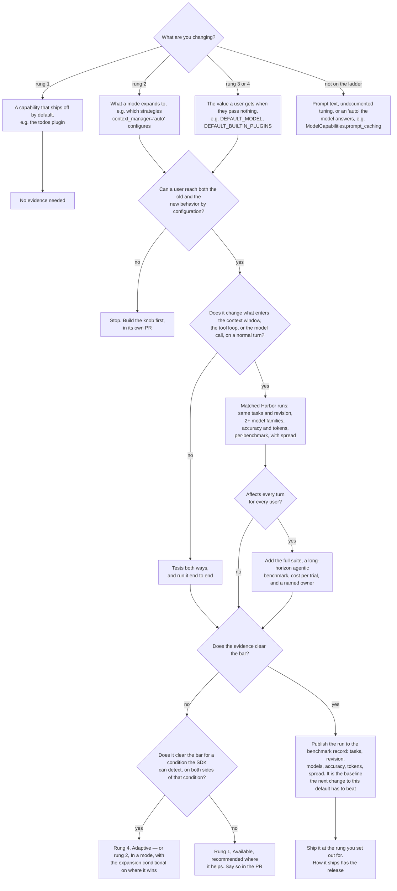

# Changing a Default

A default is the most expensive API decision we make: every user gets it, and most never read the
config reference. This document is the gate a default change passes through — how to classify it,
what evidence it needs, and how it ships in the SDK (`strands-py`, `strands-ts`) versus Strands
harness (`harness-py`, `harness-ts`) and the CLI. It sits between
[FEATURE_LIFECYCLE.md](./FEATURE_LIFECYCLE.md) (how features arrive and leave) and
[COMPATIBILITY.md](./COMPATIBILITY.md) (what counts as breaking); neither answers "should this be on
for everyone, and how would we know."

**A default is earned by evidence, not by enthusiasm.** Off-by-default is cheap and reversible.
On-by-default is a claim that it helps the median user, and that claim gets measured.

## The promotion ladder

Nothing lands directly on rung 3 or 4. Each rung is a separate decision with a separate bar.

| Rung | State | What it costs the user | Bar |
|---|---|---|---|
| 1 | **Available** — selectable by name, documented, and recommended for the cases it helps | nothing | code and docs review, plus a stated "when" if you recommend it |
| 2 | **In a mode** — part of what a named mode like `"auto"` configures, so anyone who wrote that one keyword gets it | everyone who wrote the keyword pays | this document, at the tier its blast radius sets |
| 3 | **Default** — on for everyone, including users who configured nothing | everyone pays | this document, at the tier its blast radius sets |
| 4 | **Adaptive** — off until the SDK judges the situation calls for it, then on without the user naming it or a mode | only the situations it fires in pay | this document, plus evidence on **both** sides of the trigger and a visible signal |

### An SDK mode is not automatically a harness default

The SDK offers the mode; the harness decides. What picks the harness rung is what the benefit
depends on:

- Nothing situational → **Default** (rung 3).
- A condition the harness can observe → **Adaptive** (rung 4).
- Something only the user knows, such as risk tolerance → **stays a mode** (rung 2), and the
  harness's job is making the keyword discoverable.

A per-turn cost with a situational benefit is the todos trap: Adaptive (rung 4) at best, never
Default (rung 3).

## The decision tree

## The bar

A default must **win on at least one axis and lose on neither**:

| Accuracy | Tokens / cost | Where it holds | Verdict |
|---|---|---|---|
| up | down or flat | every family and benchmark | **Default** (rung 3) |
| flat | down | every family and benchmark | **Default** (rung 3) — efficiency alone is a win |
| up | up | every family and benchmark | **In a mode** (rung 2) — paying more for accuracy is the user's call, and a keyword like `effort` is where that choice belongs |
| up | up | some families or benchmarks | **Adaptive** (rung 4) if the SDK can detect the condition, otherwise **In a mode** (rung 2). As a default it taxes every user for a benefit some of them get |
| flat or down | anything | anywhere | ship it **Available** (rung 1), recommended only for the cases it helps. **Adaptive** (rung 4) if the SDK can detect that condition |

## How it ships

| Package | What changed | Release |
|---|---|---|
| SDK | the value of a documented default, or a default becoming conditional (**Default** / **Adaptive**, rungs 3 and 4) | **major** — [Pay for Play does not cover default behavior](./FEATURE_LIFECYCLE.md#pay-for-play-opt-in-breaking-changes) |
| SDK | what a preset or `"auto"` expands to (**In a mode**, rung 2) | **minor**, named in the release notes |
| SDK | a new capability, off by default, experimental or not (**Available**, rung 1) | minor |
| harness / CLI | the value of a documented default, or a default becoming conditional (**Default** / **Adaptive**, rungs 3 and 4) | **minor** — 0.x minor *is* the breaking channel ([versioning](../site/src/content/docs/user-guide/harness/versioning.mdx)) |
| harness / CLI | a new tool or plugin, off by default (**Available**, rung 1) | patch |

Recommending something in the docs ships no code. Prompt text and undocumented tuning are not on
the ladder — they change nothing a user configured — and ship in an SDK minor or any harness release.

## Action items

Gaps this document exposes. Each needs an owner and an issue.

- **The SDK needs a defaults home.** Harness defaults live in one file; the SDK's `DEFAULT_*`
  constants are scattered per module and many values exist only in a signature, so a default change
  has no single place to review. Until then, name the constant beside the type it configures.
- **Adaptive (rung 4) is unbuilt.** Neither SDK can turn a capability on by observing the run, so a
  situational win has to settle for rung 1 or get forced to rung 3, where it loses.
- **The benchmark record does not exist.** The tree says to publish a winning run so the next change
  to that default has a baseline to beat, but today a PR description is the only record and nothing
  indexes it. Defaults outlive their measurements.
- **No current default has cleared this bar.** Every `DEFAULT_*` value predates the document.

## Worked example: `todos`

The todos plugin shipped in `DEFAULT_BUILTIN_PLUGINS` in both harnesses, rendering the task list
into **every turn**. Measured on Harbor it showed no accuracy benefit on either the Claude or GPT
families and cost tokens — *accuracy flat, tokens up*, the row that is never a Default. It left the
defaults in #5974 and now lives in the SDK as a vended plugin (#6084), at rung 1 — **Available**.
