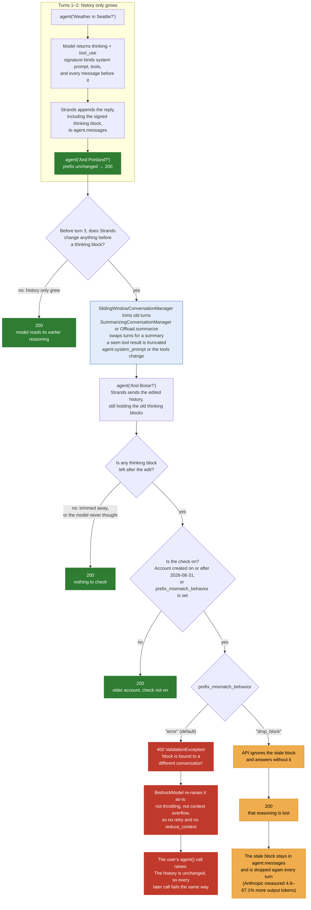
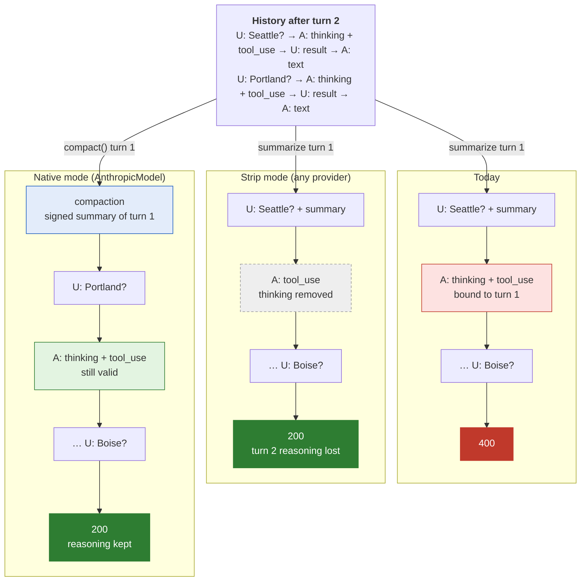
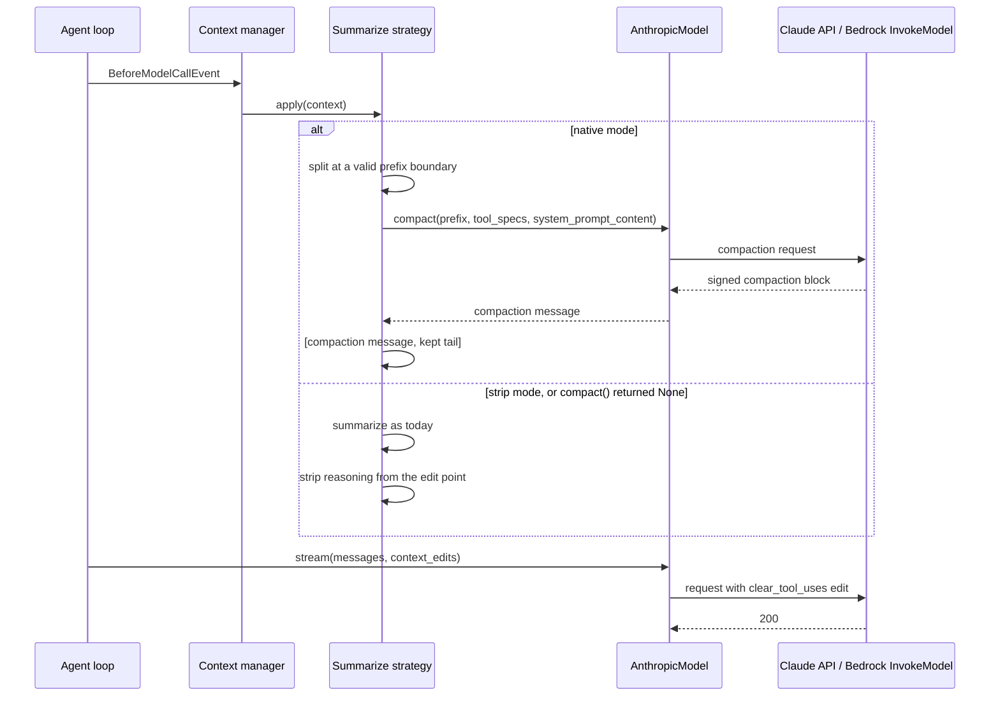
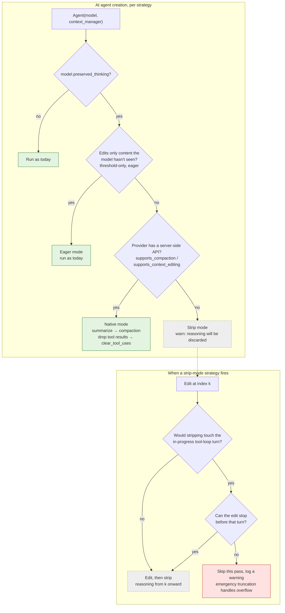

# Preserved Thinking Compatibility

**Date**: 2026-10-13

**Issue**: [#4933](https://github.com/strands-agents/harness-sdk/issues/4933)

 Both SDKs. Deliverable 1 keeps summarization and tool-result dropping working on preserved-thinking models (Claude Opus 5.5, Sonnet 5.5, and Fable 5.1) through Claude's server-side compaction and context editing. Deliverable 2 covers the edits the SDK does not route through a summarizer.

**Related**: Builds on the model-side compaction proposal ([#4742](https://github.com/strands-agents/harness-sdk/pull/4742), implementation [#4752](https://github.com/strands-agents/harness-sdk/pull/4752)), and design [0015](./0015-context-manager.md), the context manager.

## Overview

Claude Opus 5.5, Claude Sonnet 5.5, and Claude Fable 5.1 bind each thinking block to the conversation that produced it. Any edit to an earlier turn, the system prompt, or the tool list invalidates every later thinking block, and replaying one is a 400. Every built-in Strands summarizer edits history, so long-running agents on these models fail mid-session.

Deliverable 1 marks these models with a `preserved_thinking` flag on the model. When it is set, the context manager and `SummarizingConversationManager` stop rewriting history themselves: summarization goes to Claude's compaction API, and dropping tool results goes to Claude's context editing API. Edits with no server-side equivalent strip the invalidated reasoning instead of failing. `AnthropicModel` accepts an `AnthropicBedrock` client, so Amazon Bedrock users get the same behavior through InvokeModel.

## Goals and non-goals

**Goals (deliverable 1):**
- `Offload.summarize` and `SummarizingConversationManager` work on these models and keep reasoning, through compaction.
- `Offload.drop` on tool results works and keeps reasoning, through `clear_tool_uses_20250919`.
- Every other SDK edit, including emergency truncation, strips reasoning from the edit point instead of returning a 400.
- Bedrock users get compaction by passing an `AnthropicBedrock` client to `AnthropicModel`.
- Agents that use a summarizer, `Offload.drop`, or the context manager presets keep working with no code change. Agents on the default `SlidingWindowConversationManager` are covered in deliverable 2 ([open question 10](#open-questions)).

**Non-goals (deliverable 1, moved to [deliverable 2](#deliverable-2)):**
- `SlidingWindowConversationManager`, system prompt and tool list changes, and user code that edits `agent.messages`.
- `compact()` for providers other than Anthropic, and compaction through Bedrock Converse.

## Problem

A *thinking block* is the API's wire type; Strands stores the same content as a *reasoning* content block (`reasoningContent` / `ReasoningContentBlock` in Python, `ReasoningBlock` in TypeScript). Each thinking block's signature records the `system` prompt, the `tools`, and every message before it. When the history comes back, the API checks that this prefix is unchanged, and rejects the request if it isn't. Retrying the same body fails the same way.

Anthropic runs the check wherever Claude is served: the Claude API, Amazon Bedrock (Converse and InvokeModel), and Google Cloud. It is on by default for accounts created on or after 2026-08-31, and older accounts opt in by setting `thinking.block_binding.prefix_mismatch_behavior`. There is no documented way to turn it off.

Strands users hit this when a summarizer or conversation manager reduces context, or when they change `agent.system_prompt` or the tools between invocations. Library authors on older accounts can ship code that works for them and fails for their users on new accounts.

### Current State

Each thinking block is bound to everything sent before it:



Strands treats `agent.messages` as freely editable. Each built-in edit against `global.anthropic.claude-opus-5-5` was reproduced through both Bedrock Converse (`BedrockModel`) and Bedrock InvokeModel (see appendix for test script):

| Strands behavior | Result |
|---|---|
| Append-only history | 200 |
| `SlidingWindowConversationManager` trims old turns | 400, "content that preceded this block … is missing, starting at `messages.0`" |
| `SummarizingConversationManager` summarizes and keeps a tail | 400, "content before this block was rewritten" |
| `agent.system_prompt` changed between turns | 400, "the `system` prompt differs" |
| Tool result truncated in place (`_truncate_tool_results`, offload strategies) | 400, "content before this block differs" |

```
ValidationException ... ConverseStream ... messages.1.content.0: Invalid `signature` in `thinking` block.
The block is bound to a different conversation. Remove the block, or set
`thinking.block_binding.prefix_mismatch_behavior` to "drop_block".
```

The context manager makes the same edits. Its default pipeline (the `auto` and `agentic` presets) is an eager tool-result truncation, a message-level `Offload.summarize("*")`, and an `EmergencyTruncateStrategy` that the manager always appends. The eager truncation is safe because it runs on `MessageAddedEvent`, before the model sees the content. The summary is inserted after message 0 (`summarize.ts`, `summarize.py`), and the emergency step drops the oldest 20% of messages after message 0, so both invalidate every later thinking block.

## Proposal

### Recommended: route summarization and drops to Claude's server-side APIs

Each reduction path checks the model's flags and picks one of three modes: **native** (the server does the work and reasoning survives), **eager** (the edit lands before the model sees the content, so nothing is invalidated), or **strip** (the SDK edits as today, then removes reasoning from the edit point to the end).

| Strands path | Native: model supports it | Strip: otherwise |
|---|---|---|
| `Offload.summarize("*")`, message-level | `Model.compact()` on a prefix of the history | Client summary, then strip from the insert point |
| `SummarizingConversationManager` | `Model.compact()` on the prefix it already summarizes | Client summary, then strip from 0 |
| `Offload.drop("tool_results")` or `Offload.drop(["!tool::x"])`, with `utilization` or `preserve_recent` | `clear_tool_uses_20250919` on every request | Client drop, then strip from the first edited message |
| Per-block strategy with `threshold` only | Eager, unchanged | Eager, unchanged |
| Any other strategy configuration | Strip | Strip |
| `EmergencyTruncateStrategy` | Strip from 1 | Strip from 1 |

Prose uses Python names; TypeScript uses the camelCase equivalents (`"tool_results"` ↔ `'toolResults'`, `preserve_recent` ↔ `preserveRecent`). In a tool list, `"!tool::x"` excludes a tool and maps to `exclude_tools`; an include list such as `["tool::x"]` has no `clear_tool_uses` equivalent and is strip mode.

The API accepts removing thinking blocks from either end of the history but not leaving a gap, so strip mode removes all reasoning from the edit index to the end.

What `Offload.summarize("*")` sends on turn 3, today and in each mode:



The changes, referred to below as items:

1. **Model flags.** `preserved_thinking` is a model config key that defaults from a table keyed by model ID, like `context_window_limit`; it turns everything below on. `supports_compaction` and `supports_context_editing` are read-only provider properties, not config, because they depend on the provider's transport: `BedrockModel` (Converse) rejects both, so letting users set them would only produce 400s.
2. **`ContextManager.initAgent` / `init_agent`** reads the three flags from `agent.model` and passes them to each strategy's `init`. Strategies resolve them again in `apply()` if the agent's model is replaced.
3. **`BaseOffloadStrategy.init`** picks the strategy's mode from the table. A strategy that lands in strip mode while `preserved_thinking` is set raises a developer warning (`warnings.warn` in Python, `warnOnce(logger, ...)` in TypeScript) that reasoning will be discarded, so the user can reconfigure. `EmergencyTruncateStrategy` is exempt, because the manager appends it to every pipeline; it logs a `logger.warning` when it actually fires. With that exemption, both presets map entirely to native or eager modes on `AnthropicModel` and don't warn.
4. **`SummarizeStrategy` in native mode** calls `agent.model.compact()` on a prefix of the history, not the arbitrary eligible set it summarizes today. The split keeps at least `preserve_recent` messages, stops before the first pinned message, and never separates a tool use from its result. The compaction message replaces the prefix. `SummarizeConfig.system_prompt` becomes the compaction `instructions`. When `compact()` returns `None`, the strategy falls back to strip mode for that pass (see [when `compact()` returns `None`](#when-compact-returns-none)).
5. **`DropStrategy` in native mode** leaves `agent.messages` alone and registers a context edit with the agent at `init`; the event loop passes it to the model on every request. `utilization` maps to an `input_tokens` trigger (utilization × `context_window_limit`); with no `utilization`, the trigger is `tool_uses` at `preserve_recent + 1`, which clears whenever there are more results than the strategy keeps. `preserve_recent` maps to `keep.tool_uses`, and `["!tool::x"]` to `exclude_tools`. `threshold`, include lists, and `"tool_result_errors"` have no equivalent and fall to strip mode.
6. **`SummarizingConversationManager`** already summarizes a prefix (`messages[:summary_ratio × n]`, capped by `preserve_recent_messages`), so native mode passes that prefix to `compact()`. A custom `summarization_system_prompt` becomes `instructions`; the default prompt is not sent. A `summarization_agent` is ignored in native mode with a warning, like `SummarizeConfig.model` ([open question 5](#open-questions)). In strip mode the manager warns the first time it reduces context.
7. **`EmergencyTruncateStrategy`** stays a plain drop. It is the step that must always succeed, makes no model call, and only fires after the summarize strategy has already tried compaction on overflow. It strips from index 1 after dropping; message 0, including a compaction block, survives.
8. **Strip mode never reaches into the in-progress tool-loop turn.** A strategy can fire between an assistant `thinking + tool_use` turn and the model call that continues it. Anthropic has required that turn's thinking block during tool use, so stripping it may itself be a 400. When an edit would touch that turn, the strategy moves its edit point before the turn; if it can't, it skips the pass and logs a warning. Emergency truncation follows the same rule. If nothing is left to drop, the overflow surfaces as `ContextWindowOverflowException`, as it does today; that is the only error a user sees.
9. **`AnthropicModel` accepts a client.** `AnthropicBedrock` speaks the same Messages API over Bedrock InvokeModel, which supports compaction and `clear_tool_uses` (see [platform availability](#platform-availability)). Python takes `client=` alongside `client_args=` (mutually exclusive); TypeScript widens `client` to `Anthropic | AnthropicBedrock`.
10. **The `compaction` content block** carries the signed summary through `agent.messages`, sessions, and streaming.

Every native path calls `agent.model`, not `agent.aux_model`, because the compaction block is signed for the model that continues the conversation. This is an exception to the cross-SDK auxiliary-model rule, recorded in `DECISIONS.md` in the same PR as this design. When `SummarizeConfig.model` is set, compaction still wins and a warning says the configured model is ignored ([open question 5](#open-questions)).



**Pros:**
- Summarizer users on these models keep their reasoning and stop failing, with no code change on `AnthropicModel`.
- Bedrock users get the same result by passing an `AnthropicBedrock` client, with no new transport.
- Every SDK-owned edit is safe on every provider: strip mode is the fallback for anything native mode can't express, including `BedrockModel` (Converse).
- Compaction and context editing are Anthropic's recommended replacements for client-side summaries and drops.

**Cons:**
- `BedrockModel` (Converse) users lose reasoning at every summary until they move to `AnthropicModel` with an `AnthropicBedrock` client.
- Compaction runs on `agent.model`, which costs more than a cheaper `aux_model` summarizer.
- Each summarize and drop strategy gets a second code path.
- The `compaction` block and the context edit type are new public types touching serialization, session persistence, streaming, and everything that walks content blocks. Compaction cost is reported only in `usage.iterations`.
- Agents on the default `SlidingWindowConversationManager` still fail until deliverable 2.

### Interface

```python
# strands-py/src/strands/models/model.py
class BaseModelConfig(TypedDict, total=False):
    context_window_limit: int | None
    preserved_thinking: bool | None  # overrides the defaults table


class ClearToolUsesEdit(TypedDict, total=False):
    trigger_input_tokens: int  # exactly one trigger is set
    trigger_tool_uses: int
    keep_tool_uses: int
    exclude_tools: list[str]


class Model(abc.ABC):
    @property
    def preserved_thinking(self) -> bool:
        """Resolved as the preserved_thinking config key > the defaults table by model ID > False."""

    @property
    def supports_compaction(self) -> bool:
        return False

    @property
    def supports_context_editing(self) -> bool:
        return False

    async def compact(
        self,
        messages: Messages,
        tool_specs: list[ToolSpec] | None = None,
        *,
        system_prompt_content: list[SystemContentBlock] | None = None,
        instructions: str | None = None,
        cancel_signal: threading.Event | None = None,
        **kwargs: Any,
    ) -> Message | None:
        """Return a message holding a compaction block, or None if unsupported or no summary."""
        return None

    # stream() gains a keyword-only `context_edits: list[ClearToolUsesEdit] | None = None`;
    # providers without context editing ignore it.


# strands-py/src/strands/types/content.py; ContentBlock gains `compaction: CompactionContentBlock`
class CompactionContentBlock(TypedDict):
    content: str                  # the readable summary
    signature: NotRequired[str]   # opaque; must round-trip byte-for-byte
    provider: NotRequired[str]    # provider that produced the signature, e.g. "anthropic"


# strands-py/src/strands/models/anthropic.py
class AnthropicModel(Model):
    def __init__(
        self,
        *,
        client: anthropic.AsyncAnthropic | anthropic.AsyncAnthropicBedrock | None = None,
        client_args: dict[str, Any] | None = None,
        **model_config: Unpack[AnthropicConfig],
    ) -> None: ...
```

```typescript
// strands-ts/src/models/model.ts
export interface BaseModelConfig {
  contextWindowLimit?: number
  preservedThinking?: boolean
}

export interface ClearToolUsesEdit {
  triggerInputTokens?: number // exactly one trigger is set
  triggerToolUses?: number
  keepToolUses?: number
  excludeTools?: string[]
}

export interface CompactOptions {
  systemPrompt?: SystemPrompt
  toolSpecs?: ToolSpec[]
  instructions?: string
  cancelSignal?: AbortSignal
}

export abstract class Model<T extends BaseModelConfig = BaseModelConfig> {
  get preservedThinking(): boolean { ... }
  get supportsCompaction(): boolean { return false }
  get supportsContextEditing(): boolean { return false }
  async compact(messages: Message[], options?: CompactOptions): Promise<Message | undefined> {
    return undefined
  }
}
// StreamOptions gains `contextEdits?: ClearToolUsesEdit[]`.

// strands-ts/src/types/messages.ts
export interface CompactionBlockData { content: string; signature?: string; provider?: string }
export class CompactionBlock { readonly type = 'compactionBlock' as const; ... }

// strands-ts/src/models/anthropic.ts
export interface AnthropicModelOptions { client?: Anthropic | AnthropicBedrock; ... }
```

`AnthropicBedrock` comes from `@anthropic-ai/bedrock-sdk`, an optional peer dependency imported as a type only.

**Provider contract.** A provider adopts the standard by adding its model IDs to the `preserved_thinking` defaults table (`_defaults.py` / `defaults.ts`, prefixes stripped as for `context_window_limit`) and, optionally, implementing `compact()` and `context_edits`. `AnthropicModel` reports both capabilities with either client.

**The `compaction` block** goes through [API bar raising](../API_BAR_RAISING.md). The shared message normalization step rewrites a block from another provider into a labeled text block ([open question 8](#open-questions)), so no other formatter changes. `AnthropicModel` sends its own blocks verbatim and adds the `compact-2026-09-04` header whenever one is present, which survives session restore with no extra state. Strategies and conversation managers never trim, summarize, or offload the block, and the next `compact()` replaces it.

**Strip helper.** An internal `_strip_reasoning(messages, start) -> int` (`strands/agent/_reasoning.py`; in TypeScript `agent/reasoning.ts`, tagged `@internal` and kept out of the `index.ts` barrel) removes reasoning blocks from `start` to the end and returns the count. Every strip-mode path calls it only when `model.preserved_thinking` is set, and logs at debug level.

### Alternative: strip on every edit first, compaction later

A reasoning guard that diffs each request against the last one and strips from the first difference, shipped before any compaction support. This was the first draft of this design and is now [deliverable 2](#deliverable-2).

- **Pros:** fixes every 400 at once, including sliding window, system prompt changes, and user edits.
- **Cons:** loses reasoning at every edit, which costs output tokens and resets the prompt cache, and gives summarizer users no way to keep it. A diff-based guard also has no baseline after session restore and runs before tool specs are resolved in the event loop.

### Alternative: a Bedrock InvokeModel transport inside `BedrockModel`

`BedrockModel` sends Messages API requests through InvokeModel when the model supports compaction.

- **Pros:** `BedrockModel` users keep reasoning without switching providers.
- **Cons:** a second wire format inside `BedrockModel`, duplicating what `AnthropicModel` does with an `AnthropicBedrock` client.

### Alternative: throw on unsupported strategy configurations

Raise at `init` when a strategy can't run natively, instead of warning and stripping.

- **Pros:** the user learns at construction time, not by losing reasoning.
- **Cons:** breaks existing agents whose configurations work today until an edit happens, and every `BedrockModel` agent with a summarizer.

### Alternative: carry the summary as a text block plus signature

The choice in [#4742](https://github.com/strands-agents/harness-sdk/pull/4742): a `text` block with an extra `signature` key, which `AnthropicModel` sends as a `compaction` block.

- **Pros:** no new public type.
- **Cons:** the type misdescribes the content, and code that merges or rewrites text blocks can silently drop the signature. With the normalization step, the new block costs no formatter changes either.

### Alternative: threshold compaction

Let the server compact inside a normal request once input tokens cross a trigger.

- **Pros:** almost no SDK surface, and no extra round trip.
- **Cons:** the trigger can't go below 50,000 tokens, it competes with the context manager's own pipeline, and it can't be combined with `clear_tool_uses`.

### Alternative: send `drop_block` by default

Set `prefix_mismatch_behavior: "drop_block"`, so the API drops invalid blocks instead of returning a 400.

- **Pros:** a one-line change per provider.
- **Cons:** invalid blocks stay in `agent.messages` forever. Anthropic measured 4.6%–67.1% more output tokens when blocks are dropped every turn, and calls it a stopgap. The drop is silent, and setting the field opts accounts created before 2026-08-31 into enforcement.

## Developer Experience

Each strategy's mode is chosen when the agent is created, and chosen again if `agent.model` is replaced. Whether a strip-mode edit can go ahead is decided each time the strategy fires:



The runtime phase exists only if the API requires the in-progress turn's thinking ([open question 11](#open-questions)). If it doesn't, every strip-mode edit goes straight to "edit, then strip".

On `AnthropicModel`, the default context manager keeps reasoning with no code change:

```python
from strands import Agent
from strands.models.anthropic import AnthropicModel

agent = Agent(
    model=AnthropicModel(model_id="claude-opus-5-5", max_tokens=8000),
    context_manager="auto",
)
agent("Audit the repository")  # when summarization fires, it compacts on the server and reasoning survives
```

Amazon Bedrock users pass an `AnthropicBedrock` client:

```python
from anthropic import AsyncAnthropicBedrock
from strands import Agent
from strands.agent.conversation_manager import SummarizingConversationManager
from strands.models.anthropic import AnthropicModel

model = AnthropicModel(
    client=AsyncAnthropicBedrock(aws_region="us-west-2"),
    model_id="global.anthropic.claude-opus-5-5",
    max_tokens=8000,
)
agent = Agent(model=model, conversation_manager=SummarizingConversationManager())
```

On `BedrockModel`, the same agent works and warns once that summaries discard reasoning:

```python
from strands import Agent
from strands.agent.conversation_manager import SummarizingConversationManager
from strands.models import BedrockModel

agent = Agent(
    model=BedrockModel(model_id="global.anthropic.claude-opus-5-5"),
    conversation_manager=SummarizingConversationManager(),
)
# UserWarning: model does not support compaction; summarization will discard reasoning on this model
```

A model not yet in the defaults table, such as an application inference profile ARN, opts in through config:

```python
model = AnthropicModel(
    client=AsyncAnthropicBedrock(aws_region="us-west-2"),
    model_id="arn:aws:bedrock:us-west-2:111122223333:application-inference-profile/abc123",
    max_tokens=8000,
    preserved_thinking=True,
)
```

## Rollout

### Deliverable 1

One PR per step per SDK:

1. **Flags and strip mode:** `preserved_thinking` with defaults for the three models, the capability properties, the strip helper, mode selection in `BaseOffloadStrategy.init`, and strip mode in every strategy, `SummarizingConversationManager`, and `EmergencyTruncateStrategy`. This alone ends the 400s for summarizer users on every provider, at the cost of reasoning.
2. **`AnthropicModel` client injection** for `AnthropicBedrock`. It lands ahead of the compaction work because it is independent; until step 4 merges, Bedrock users on this client get strip mode, not compaction.
3. **The `compaction` block** and the normalization step, after API bar raising.
4. **`Model.compact()`**, `AnthropicModel.compact()`, native mode in `SummarizeStrategy` and `SummarizingConversationManager`, and a `compaction_iterations` / `compactionIterations` usage metric. Builds on [#4752](https://github.com/strands-agents/harness-sdk/pull/4752), swapping its signed text block for the `compaction` block.
5. **Context edits:** `ClearToolUsesEdit`, the `stream()` option, `AnthropicModel` support, and native mode in `DropStrategy`.

### Deliverable 2

- `SlidingWindowConversationManager` in strip mode, or compacting instead of trimming.
- A reasoning guard for edits the SDK doesn't own: system prompt and tool list changes (including the structured output tool, which is added for each structured-output invocation and sent alone in forced mode), and user code that edits `agent.messages`.
- A one-time recovery: on the "bound to a different conversation" 400, strip all reasoning and retry once. This covers unknown model IDs, session restore, and edits the guard misses.
- Mid-conversation system messages and `tool_addition` / `tool_removal` blocks, so instruction and tool changes keep reasoning.

## Verification

- Mode selection unit tests: each row of the mode table, for a model with and without each capability, and with `preserved_thinking` off (no change from today).
- Strip helper tests: an edit at *k* strips from *k* only; nothing is stripped when `preserved_thinking` is off.
- Every [reproduction scenario](#appendix-reproduction-snippets) for summarizers returns 200 in both SDKs on `AnthropicModel` with each client, and on `BedrockModel` in strip mode.
- After compaction, the next request keeps the tail's thinking and returns 200, as the API already does on Bedrock InvokeModel ([snippet](#native-messages-api-bedrock-invokemodel)). When `compact()` returns `None`, the strip fallback also returns 200.
- Compaction triggered in the middle of a tool loop: the split falls between a tool result and the next assistant turn, and the request returns 200 with the tail's thinking kept.
- `Offload.drop("tool_results")` in native mode sends the `clear_tool_uses` edit and returns 200 with `applied_edits` reported.
- Emergency truncation on an overflowing history returns 200.
- Thinking stripped from the in-progress tool-loop turn ([snippet](#strands-bedrockmodel-converse)): a 400 confirms the runtime rule is needed; a 200 removes it.
- Strip mode that would touch the in-progress turn moves its edit point or skips the pass, and never sends a request with that turn's thinking removed.

## Open questions

1. Should `compact()` and the capability properties live on `Model` or a separate capability protocol?
2. **Compaction message role. Resolved 2026-10-13:** the block goes in a user message. With the block in a user message, a turn-boundary split (2 tail thinking blocks) and a split inside a tool loop (1 thinking block in the in-progress turn) both returned 200 on Bedrock InvokeModel with the tail's thinking intact ([native snippet](#native-messages-api-bedrock-invokemodel)).
3. The API also returns `encrypted_content` and `tool_changes` on the block (both null in our runs) and rejects fields it didn't return. Should `CompactionContent` model them now, or round-trip unknown fields as-is?
4. How should context edits reach the provider: a `stream()` keyword (proposed), or state the strategy sets on the model?
5. When `SummarizeConfig.model` is set, should compaction override it (proposed, with a warning), or should an explicit summarizer model mean strip mode?
6. Does Bedrock support `messages.count_tokens` through `AnthropicBedrock`? If not, `AnthropicModel.count_tokens` falls back to estimation on that client.
7. With `clear_tool_uses` active, `agent.messages` keeps the full tool results, so a client-side token count overstates utilization and may fire summarization early. Should the context manager discount cleared results, or rely on the last response's reported input tokens?
8. How should a foreign `compaction` block render? Proposed: a labeled text block ("Summary of earlier conversation: …"), so the model reads it as context, not as prior turns or instructions.
9. If Anthropic changes the `compact-2026-09-04` beta: proposed, `compact()` returns `None` on rejection, so strategies fall back to strip mode, which uses no beta.
10. Should strip mode for `SlidingWindowConversationManager` move into deliverable 1? It is the default, so agents that never configured a summarizer still fail until deliverable 2.
11. Does the API reject a request whose in-progress tool-loop turn has its thinking removed? If not, drop the runtime rule in item 8 of the proposal. Both [reproduction scripts](#appendix-reproduction-snippets) check it.
12. Should strip mode warn at agent creation (proposed, so existing agents keep working), throw, or log at debug level only?

## Future work

- `compact()` for other providers that offer signed server-side summaries.
- Threshold compaction as an opt-in passive mode.
- A Bedrock InvokeModel transport in `BedrockModel`, if `AnthropicBedrock` through `AnthropicModel` proves insufficient.

## Additional Details

<details>
<summary>Platform availability, the compact() sketch, and the deliverable 2 guard</summary>

The [reproduction snippets](#appendix-reproduction-snippets) set `prefix_mismatch_behavior: "error"`, so they reproduce from accounts created before 2026-08-31 too.

### Platform availability

| Feature | Claude API | Bedrock InvokeModel | Bedrock Converse |
|---|---|---|---|
| `block_binding` / `drop_block` | beta | beta | passes through `additionalModelRequestFields` |
| Context editing (`clear_tool_uses`, `clear_thinking`) | beta | beta (`clear_tool_uses` verified) | not supported |
| Threshold compaction (`compact_20260112`, 50K-token minimum trigger) | beta | beta | no `compaction` content type |
| On-demand compaction (`compact-2026-09-04`) | beta | beta (verified) | rejected |
| Mid-conversation system messages | GA | GA (verified) | not supported |

On the Messages API path, two of Anthropic's append-only replacements also passed: an appended `role: "system"` message instead of a system prompt edit, and `clear_tool_uses_20250919` instead of truncating tool results.

On-demand compaction on Bedrock InvokeModel, verified 2026-10-13 (and by #4742 on 2026-09-29):
- The response is an assistant message with one `compaction` block (`content`, `signature`), `stop_reason: "compaction"`, and zero top-level tokens; the cost is in `usage.iterations`.
- `[compaction message, kept tail]` returns 200 with the tail's thinking intact under `prefix_mismatch_behavior: "error"`.
- The same request without the `compact-2026-09-04` header returns 400: `compaction` is an unknown block type.
- The block also works in a user message, verified 2026-10-13: with the split at a turn boundary or inside a tool loop, the tail's thinking stays valid and the next request returns 200 ([open question 2](#open-questions)).
- Changing the block's text or signature returns `compaction_signature_invalid` or `compaction_content_mismatch` (per #4742).

### `AnthropicModel.compact()` sketch

```python
@override
async def compact(
    self,
    messages: Messages,
    tool_specs: list[ToolSpec] | None = None,
    *,
    system_prompt_content: list[SystemContentBlock] | None = None,
    instructions: str | None = None,
    cancel_signal: threading.Event | None = None,
    **kwargs: Any,
) -> Message | None:
    request = self.format_request(messages, tool_specs, system_prompt_content=system_prompt_content)
    compaction: dict[str, Any] = {"type": "summarize", **({"instructions": instructions} if instructions else {})}
    try:
        # The client doesn't model the compaction parameter or block yet, hence extra_body and model_dump().
        response = await self.client.beta.messages.create(
            **request, betas=[COMPACT_BETA], extra_body={"compaction": compaction}
        )
    except anthropic.RateLimitError as error:
        raise ModelThrottledException(str(error)) from error
    except anthropic.BadRequestError as error:
        if any(overflow_message in str(error).lower() for overflow_message in AnthropicModel.OVERFLOW_MESSAGES):
            raise ContextWindowOverflowException(str(error)) from error
        logger.warning("error=<%s> | compaction request rejected, falling back to strip mode", error)
        return None

    block = next((block for block in response.model_dump()["content"] if block["type"] == "compaction"), None)
    if block is None:
        logger.warning("stop_reason=<%s> | compaction returned no summary, falling back to strip mode", response.stop_reason)
        return None
    compaction_block: CompactionContentBlock = {
        "content": block["content"],
        "signature": block["signature"],
        "provider": "anthropic",
    }
    return {"role": "user", "content": [{"compaction": compaction_block}]}
```

### When `compact()` returns `None`

| Cause | Signal | Then |
|---|---|---|
| No compaction block in the response (`max_tokens`, refusal, a dangling tool call) | `logger.warning` with the stop reason; the call's cost is still reported in usage | Strip mode for this pass |
| Request rejected (a beta change, an unsupported option) | `logger.warning` with the error | Strip mode for this pass |
| Throttling or context overflow | `ModelThrottledException` / `ContextWindowOverflowException` | The context manager logs the failed strategy and continues, as for any strategy error |

Both `None` cases warn rather than log at debug level, because the compaction call was paid for and reasoning is still lost.

### Deliverable 2 guard sketch

Runs in the event loop right before `stream()`, after continuation messages are appended and tool specs are resolved, so user hooks on `BeforeModelCallEvent` can't change the request after it:

```python
# strands-py/src/strands/agent/_reasoning_guard.py (internal)
class _ReasoningGuard:
    """Removes reasoning invalidated by history edits before each model call."""

    _last_request: _RequestPrefix | None  # system prompt, tool specs, and messages last sent

    def check(self, agent: Agent, tool_specs: list[ToolSpec]) -> None:
        if not agent.model.preserved_thinking:
            return
        edit_index = self._first_changed_index(agent, tool_specs)  # None if append-only or after compact()
        if edit_index is not None:
            _strip_reasoning(agent.messages, start=edit_index)
        self._last_request = _RequestPrefix.capture(agent, tool_specs)
```

</details>

<details>
<summary>Appendix: reproduction snippets</summary>

### Appendix: reproduction snippets

There are two scripts. The Strands one reproduces each failure through `BedrockModel` (Bedrock Converse). The native one exercises Anthropic's append-only replacements through the Messages API on Bedrock InvokeModel. Both set `prefix_mismatch_behavior: "error"`, so results are the same on any account age.

#### How to run

Set up a virtualenv in `strands-py/` with the SDK and the Anthropic client:

```bash
cd strands-py
uv venv && source .venv/bin/activate
uv pip install -e . "anthropic[bedrock]"
```

Both scripts call `global.anthropic.claude-opus-5-5` in `us-west-2` with your default AWS credentials (set `AWS_PROFILE` if needed), and cost a few cents per scenario.

| Script | Saved as | Run with | Expected |
|---|---|---|---|
| Strands | `strands-py/src/test_preserved_thinking.py` | `python -i test_preserved_thinking.py` from `strands-py/src`, then paste each scenario | The baseline and `drop_block` scenarios return; the tool-added and in-progress-turn scenarios are unverified; the other four raise the 400 shown in their comments |
| Native | `strands-py/src/test_preserved_thinking_anthropic.py` | `python test_preserved_thinking_anthropic.py` from `strands-py/src` | Runs top to bottom: prints the applied context edits and `compaction`, then prints `200` or `400 <message>` for the three open-question checks with the number of thinking blocks each one tested (re-run any check that reports 0), then ends with the expected 400 from the last scenario |

Thinking is adaptive, so the model sometimes skips it on a short turn. If no thinking block ends up in the history, an edit has nothing to invalidate and the scenario passes; re-run it.

#### Strands (`BedrockModel`, Converse)

`make_agent()` builds an agent with binding enforcement opted in:

```python
import json

from strands import Agent, tool
from strands.agent.conversation_manager import (
    NullConversationManager,
    SlidingWindowConversationManager,
    SummarizingConversationManager,
)
from strands.hooks import BeforeModelCallEvent
from strands.models import BedrockModel


@tool
def get_weather(city: str) -> str:
    """Get the current weather for a city.

    Args:
        city: City name.
    """
    return json.dumps({"city": city, "temp_f": 61, "conditions": "overcast"})


@tool
def get_time(city: str) -> str:
    """Get the current local time for a city.

    Args:
        city: City name.
    """
    return json.dumps({"city": city, "local_time": "14:05"})


def make_agent(conversation_manager=None, mismatch_behavior="error"):
    model = BedrockModel(
        model_id="global.anthropic.claude-opus-5-5",
        region_name="us-west-2",
        max_tokens=8000,
        additional_request_fields={
            # Setting the field (any value) opts accounts created before 2026-08-31 into enforcement.
            "thinking": {"type": "adaptive", "block_binding": {"prefix_mismatch_behavior": mismatch_behavior}},
            "anthropic_beta": ["thinking-binding-controls-2026-08-01"],
        },
    )
    return Agent(
        model=model,
        tools=[get_weather],
        system_prompt="You are a terse weather assistant. Always use the get_weather tool.",
        conversation_manager=conversation_manager or NullConversationManager(),
        callback_handler=None,
    )
```

Each scenario runs two turns, edits the history, then runs a third turn:

```python
# Baseline: append-only history -> 200
agent = make_agent()
agent("Weather in Seattle?"); agent("And Portland?"); agent("And Boise?")

# SlidingWindowConversationManager trims turn 1 -> 400
# "Content that preceded this block ... is missing, starting at `messages.0`"
agent = make_agent(SlidingWindowConversationManager(window_size=4))
agent("Weather in Seattle?"); agent("And Portland?"); agent("And Boise?")

# SummarizingConversationManager summarizes and keeps a tail -> 400
# "Content before this block was rewritten since it was created"
agent = make_agent(SummarizingConversationManager(summary_ratio=0.5, preserve_recent_messages=4))
agent("Weather in Seattle?"); agent("And Portland?")
agent.conversation_manager.reduce_context(agent)
agent("And Boise?")

# System prompt changed between turns -> 400
# "The `system` prompt differs from the one this block was created with"
agent = make_agent()
agent("Weather in Seattle?"); agent("And Portland?")
agent.system_prompt += " Answer in Celsius."
agent("And Boise?")

# Earlier tool result rewritten in place -> 400
# "Content before this block differs from when it was created"
agent = make_agent()
agent("Weather in Seattle?"); agent("And Portland?")
first_result = next(b for m in agent.messages for b in m["content"] if "toolResult" in b)
first_result["toolResult"]["content"] = [{"text": "[truncated]"}]
agent("And Boise?")

# Tool added between turns -> 400
# "The `tools` list differs from the one this block was created with."
agent = make_agent()
agent("Weather in Seattle?"); agent("And Portland?")
agent.tool_registry.process_tools([get_time])
agent("And Boise?")

# Thinking stripped from the in-progress tool-loop turn -> result unknown (open question 11)
# Runs before the call that continues the tool loop, after the tool result is appended.
def strip_in_progress_turn(event: BeforeModelCallEvent) -> None:
    messages = event.agent.messages
    if len(messages) < 2 or not any("toolResult" in block for block in messages[-1]["content"]):
        return
    messages[-2]["content"] = [block for block in messages[-2]["content"] if "reasoningContent" not in block]

agent = make_agent()
agent.add_hook(strip_in_progress_turn)
agent("Weather in Seattle?")

# Same trim as the sliding window, with drop_block -> 200 (reasoning dropped)
agent = make_agent(SlidingWindowConversationManager(window_size=4), mismatch_behavior="drop_block")
agent("Weather in Seattle?"); agent("And Portland?"); agent("And Boise?")
```

#### Native Messages API (Bedrock InvokeModel)

`make_chat()` returns a conversation that is called like a Strands agent, so each scenario mirrors the Strands ones. `chat.compact()` replaces everything before the last turn with a server-signed compaction block, and the compact beta header is added whenever one is in the history.

```python
import json

import anthropic
from anthropic import AnthropicBedrock

client = AnthropicBedrock(aws_region="us-west-2")  # uses AWS_PROFILE / default credentials
MODEL = "global.anthropic.claude-opus-5-5"
SYSTEM = "You are a terse weather assistant. Always use the get_weather tool."
TOOLS = [
    {
        "name": "get_weather",
        "description": "Get the current weather for a city.",
        "input_schema": {"type": "object", "properties": {"city": {"type": "string"}}, "required": ["city"]},
    }
]
BINDING_BETA = "thinking-binding-controls-2026-08-01"
CONTEXT_BETA = "context-management-2025-06-27"
COMPACT_BETA = "compact-2026-09-04"
CLEAR_TOOL_USES = {
    "edits": [{"type": "clear_tool_uses_20250919",
               "trigger": {"type": "tool_uses", "value": 2},
               "keep": {"type": "tool_uses", "value": 1}}]
}


class Chat:
    """A Messages API conversation through Bedrock InvokeModel, called like a Strands agent."""

    def __init__(self, context_management=None, compact_header=True):
        self.messages = []
        self.context_management = context_management
        self.compact_header = compact_header

    def __call__(self, prompt, system_note=None, on_tool_result=None):
        """Run one user turn, including its tool loop.

        on_tool_result(chat) runs after each tool result is appended, before the call that continues the loop.
        """
        self.messages.append({"role": "user", "content": prompt})
        if system_note:
            self.messages.append({"role": "system", "content": system_note})
        while True:
            response = self._create(self.messages)
            self.messages.append({"role": "assistant", "content": [b.to_dict() for b in response.content]})
            if response.stop_reason != "tool_use":
                return response
            self.messages.append({"role": "user", "content": [
                {"type": "tool_result", "tool_use_id": b.id,
                 "content": json.dumps({"city": b.input["city"], "temp_f": 61, "conditions": "overcast"})}
                for b in response.content if b.type == "tool_use"
            ]})
            if on_tool_result:
                on_tool_result(self)

    def compact(self, role="assistant", split_at="turn"):
        """Replace the older history with a server-signed compaction block.

        split_at="turn" keeps the last user turn; split_at="tool_loop" keeps only the last assistant
        tool_use turn onward, so the tail starts with an assistant message.
        """
        if split_at == "tool_loop":
            split = max(
                index for index, message in enumerate(self.messages)
                if message["role"] == "assistant"
                and any(block.get("type") == "tool_use" for block in message["content"])
            )
        else:
            split = max(index for index, message in enumerate(self.messages) if isinstance(message["content"], str))
        older, tail = self.messages[:split], self.messages[split:]
        response = self._create(older, compaction={"type": "summarize"})
        block = next(b for b in response.model_dump()["content"] if b["type"] == "compaction")
        compaction = {"type": "compaction", "content": block["content"], "signature": block["signature"]}
        self.messages = [{"role": role, "content": [compaction]}, *tail]
        return response

    def _create(self, messages, compaction=None):
        betas = [BINDING_BETA]
        extra = {}
        if self.context_management:
            betas.append(CONTEXT_BETA)
            extra["context_management"] = self.context_management
        if compaction or (self.compact_header and self._has_compaction(messages)):
            betas.append(COMPACT_BETA)
        if compaction:
            extra["extra_body"] = {"compaction": compaction}
        return client.beta.messages.create(
            model=MODEL,
            max_tokens=8000,
            betas=betas,
            system=SYSTEM,
            tools=TOOLS,
            thinking={"type": "adaptive", "block_binding": {"prefix_mismatch_behavior": "error"}},
            messages=messages,
            **extra,
        )

    @staticmethod
    def _has_compaction(messages):
        return any(
            isinstance(m["content"], list) and any(b.get("type") == "compaction" for b in m["content"])
            for m in messages
        )


def make_chat(context_management=None, compact_header=True):
    return Chat(context_management, compact_header)


def count_thinking(messages):
    """Count thinking blocks, so a 200 can be told apart from a turn where the model skipped thinking."""
    return sum(
        1
        for message in messages
        if isinstance(message["content"], list)
        for block in message["content"]
        if block.get("type") in ("thinking", "redacted_thinking")
    )


# Mid-conversation system message instead of editing the system prompt -> 200
chat = make_chat()
chat("Weather in Seattle?"); chat("And Portland?")
chat("And Boise?", system_note="Answer in Celsius from now on.")

# Context editing instead of truncating tool results -> 200, with cleared_tool_uses > 0
chat = make_chat(context_management=CLEAR_TOOL_USES)
chat("Weather in Seattle?"); chat("And Portland?")
print(chat("And Boise?").context_management.applied_edits)

# On-demand compaction instead of summarizing -> 200, the kept turn's thinking still valid
chat = make_chat()
chat("Weather in Seattle?"); chat("And Portland?")
print(chat.compact().stop_reason)  # compaction
print("tail thinking blocks after compaction:", count_thinking(chat.messages))  # 0 means nothing was tested
chat("And Boise?")


def check(name, scenario):
    """Run an unverified scenario and print its status instead of stopping the script.

    A scenario returns the thinking-block count it tested; a 200 with a count of 0 proves nothing, so re-run it.
    """
    tested = {"thinking_blocks": 0}
    try:
        scenario(tested)
        print(f"{name}: 200 (thinking blocks tested: {tested['thinking_blocks']})")
    except anthropic.BadRequestError as error:
        print(f"{name}: 400 (thinking blocks tested: {tested['thinking_blocks']}) {error.message}")


def compact_user_role_at_turn(tested):
    chat = make_chat()
    chat("Weather in Seattle?"); chat("And Portland?")
    chat.compact(role="user")
    tested["thinking_blocks"] = count_thinking(chat.messages)  # thinking kept in the tail
    chat("And Boise?")


def compact_user_role_in_tool_loop(tested):
    chat = make_chat()
    chat("Weather in Seattle?")

    def compact_once(chat):
        if not chat._has_compaction(chat.messages):
            chat.compact(role="user", split_at="tool_loop")
            tested["thinking_blocks"] = count_thinking(chat.messages)  # thinking in the in-progress turn

    chat("And Portland?", on_tool_result=compact_once)
    chat("And Boise?")


def strip_in_progress_turn(tested, attempts=5):
    def strip_thinking(chat):
        in_progress = chat.messages[-2]
        kept = [block for block in in_progress["content"] if block.get("type") not in ("thinking", "redacted_thinking")]
        tested["thinking_blocks"] += len(in_progress["content"]) - len(kept)  # thinking removed
        in_progress["content"] = kept

    # A prompt that needs reasoning makes thinking before the tool call likely; retry if the model skipped it.
    for _ in range(attempts):
        chat = make_chat()
        chat("Check Seattle and Portland, then tell me which city to visit for a dry, warm afternoon and why.",
             on_tool_result=strip_thinking)
        if tested["thinking_blocks"]:
            return


# Open question 2: compaction block in a user message, tail starts with a user turn -> result unknown
check("compaction in user message, split at turn", compact_user_role_at_turn)

# Open question 2: compaction in a user message, compacted mid tool loop, tail starts with the
# in-progress assistant turn; the loop continues, then a new turn runs -> result unknown
check("compaction in user message, split in tool loop", compact_user_role_in_tool_loop)

# Open question 11: thinking removed from the in-progress tool-loop turn -> result unknown
check("thinking stripped from in-progress turn", strip_in_progress_turn)

# Same compaction, without the compact beta header -> 400
# "Input tag 'compaction' found using 'type' does not match any of the expected tags"
chat = make_chat(compact_header=False)
chat("Weather in Seattle?"); chat("And Portland?")
chat.compact()
chat("And Boise?")
```

</details>
