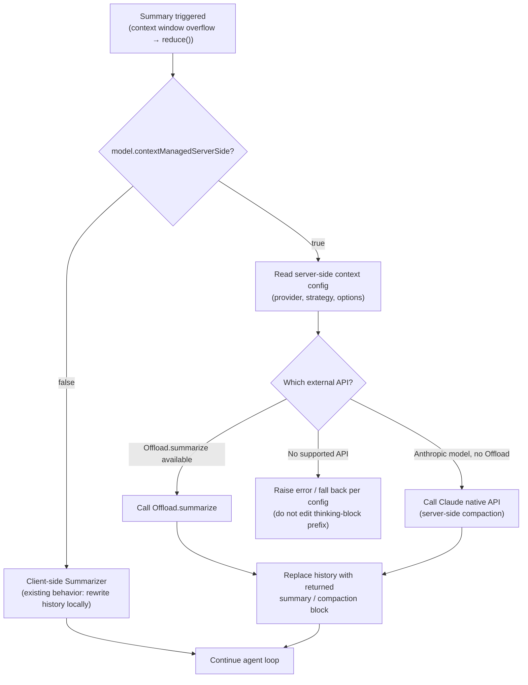

# Preserved Thinking Compatibility

**Date**: 2026-10-14

**Issue**: [#4933](https://github.com/strands-agents/harness-sdk/issues/4933)

**Scope**: Supporting Server Side Context Management Strategies

## Overview

Anthropic has introduced preserved thinking with its latest models, Claude Fable 5.1 and Claude Opus 5.5 (see tests in appendix). When calling these models over `InvokeModel` or `Converse`, Anthropic will check that any thinking block has the system prompt, the tools list, or the chat history remain the same turn over turn. If one of these elements is edited by the Strands Agents SDK, more specifically the context manager, then Anthropic returns a 400 error. Additionally, users can enable `drop_block` which will then silently drop the thinking blocks. In the Strands harness the default conversation manager uses a Summarizer when the context window becomes too large, this will fail without further changes in the SDK.  

## Problem

Anthropic's preserved thinking changes affect the way the context management can be accomplished in the Strands Agents SDK. Strands Agents SDK provides customers with context management techniques to reduce and reform the content in the agent's context window. The `SlidingWindowConversationManager` and `SummarizingConversationManager` utilize a `reduce()` method to summarize the context. Strands agents allows for editing `agent.system_prompt` between turns. Strands Agents also allows a tool result the model has already seen to be truncated or offloaded via other strategies. With preserved thinking enabled on the model, Anthropic will return a 400 error if any content in any of the thinking blocks is edited between turns. 

### Current State

Strands implements a `ContextManager` which allows users to do several things with their agent's context windows:

- Truncate
- Summarize
- Drop
- Emergency Truncation
- Agentic/model-driven editing (has 3 tools)
    - `summarize_context`
    - `truncate_context`
    - `pin_context`

Context management techniques that the Strands Agents SDK utilizes are going to return a 400 error when using models with preserved thinking (currently Fable 5.1, Sonnet 5.5, Haiku 5.5, and Opus 5.5). Preserved thinking requires that when a `thinking_block` is created, then the entire prefix (system prompt, tool list, and chat history) needs to remain the same turn over turn when sending requests to Anthropic. 

## Proposal

### Part 1: Getting Strands Summarizer to Work with Preserved Thinking Model

We want to expose a new field in the `Model` class. 

```typescript
// strands-ts/src/models/model.ts
export interface BaseModelConfig {
  contextWindowLimit?: number
  contextManagedServerSide?: boolean // TODO can we include a Config here to define how to use Anthropic (or other LLM provider) 
}
```
The new field `contextManagedServerSide` will be set to true for models that have preserved thinking. Whenever a context management strategy is implemented, the SDK needs to privately use Claude's Native API to manage the context.

Previously Strands would only implement context management techniques on the client side, but with the preserved thinking models, thinking blocks need to be tied to the prefix that created the thinking block. Any modification to the history results in an error. Anthropic allows for summarization through compaction. Strands needs to use Anthropic's compaction functions privately so that Strands users can still use the context management strategies. 

For part 1 of this fix we will focus on the `Summarizer` implementation for the case when server side context management must be utilized in. 

The following diagram is the proposed flow: 



This solution allows for further compatibility with other models if they start to enforce the same checks that Anthropic is forcing with their preserved thinking models.

### Part 2: Getting Strands ContextManager to Work with Preserved Thinking Model


## Open Questions

-[] How can we align Anthropic compact API with our API's

-[] Summarize between each thinking block

-[] Thinking block

-[] How will context injector be utilized? 

