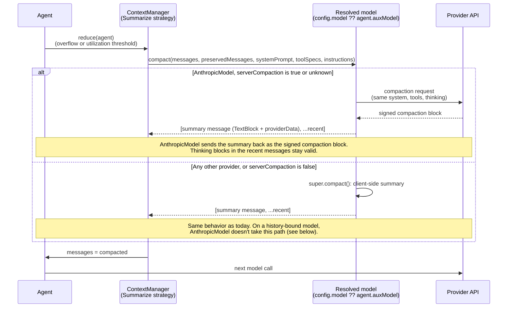

# Server Side Compaction Support

**Date**: 2026-10-14

**Issue**: [#4933](https://github.com/strands-agents/harness-sdk/issues/4933), [#5410](https://github.com/strands-agents/harness-sdk/issues/5410)

**Scope**: Supporting Server Side Context Management Strategies

## Overview

Read: https://platform.claude.com/docs/en/build-with-claude/preserved-thinking

<!-- Is there any mention of thinking blocks in any other design document?  -->

Thinking blocks that are formed by Anthropic Models (Claude Opus 5.5, Claude Fable 5.1, Haiku 5.5, and Sonnet 5.5). Strands Agents SDK accepts a thinking block as a `ReasoningBlock`: 

```typescript
export interface ReasoningBlockData {
    text?: string              // the reasoning text
    signature?: string         // cryptographic signature for verification
    redactedContent?: Uint8Array
  }
```

Each thinking block's `signature` are tied to the prefix, which includes `SystemPrompt`, `ToolsList`, and `ConversationHistory` of the LLM that generated that block. 

When an agent running in auto mode reaches a context window of 85% capacity, then the agent will summarize the oldest messages and the agent keeps the most recent 4 messages verbatim. This will fail with `preserved_thinking` models. 

Auto mode also truncates tools results automatically which will not affect preserved thinking models because the tool result is changed before a model sees the tool result and therefore not thinking block can be formed on the tool result. 

This effects customers that use the `"auto"` mode or any that use ContextManagement techniques that ever modify context. This also only effects customers that are using `preserved_thinking` Anthropic models. With this paradigm shift into LLM providers having restrictions on using their native APIs to modify context, there needs to be a universal way to switch to server side context management techniques for the specific LLM provider you are dealing with at that point in time. 

## Problem

Server-side context management ensures that thinking data is private to the LLM provider. More and more LLM providers may follow Anthropic's lead. This affects how Strands modifies `chat_history`, `tools_lists`, and `system_prompts`.

Agent developers are finding new ways to increase agent performance when modifying the context window to save performance. It is a common strategy to limit token usage. How do agent developers continue to modify every bit of data in an agent's context history while respecting LLM provider's restrictions?

Strands modifies content in the context window through the current ContextManagement [methods](https://github.com/strands-agents/harness-sdk/tree/main/strands-ts/src/context-manager/methods). These functions will be affected by Anthropic's preserved thinking changes.

### Current State

Strands has no concept of preserved-thinking compatibility today. Dropping thinking blocks is effectively how context reduction already behaves: when a context-reduction strategy removes or rewrites a message, any `ReasoningBlock` inside it is simply dropped from the next request's history — nothing recognizes that the block's `signature` is tied to a prefix that must stay intact.

The one place reasoning content gets special treatment today is at the sub-message (block) level: [`BaseOffloadStrategy._blockMatchesTarget`](https://github.com/strands-agents/harness-sdk/blob/main/strands-ts/src/context-manager/strategies/offload/base.ts) explicitly excludes `ReasoningBlock` from being targeted by per-block offload strategies, so block-level truncate/drop strategies skip over thinking content rather than editing it in place. There is no equivalent protection at the *message* level: the message-level `Offload.drop`/`Offload.summarize` strategies remove or replace whole messages without checking whether a dropped message carries a thinking block tied to the live prefix. 

## Proposal

For the first part of this solution, the summarizer method for Anthropic models with Preserved Thinking will be written to go through the Claude Native API. This will allow for server side context management and then Anthropic will not return a 400 error. 

## Approach 1: Server-side context management versus client-side context management

Anthropic's preserved-thinking models return a 400 when the prefix of a thinking block has been modified. So whenever Strands summarizes the history of one of these models, the summary has to come from Claude's API (server-side compaction) rather than from a client-side summarizer.

The SDK needs this path to work for any provider, without the context manager knowing which provider it is talking to. Token counting already solves the same problem: `Model.countTokens()` has a working default (a heuristic estimate), and providers with a native API override it (`AnthropicModel`, `BedrockModel` and `GeminiModel` call their provider's count-tokens API and fall back to `super`). Callers only ever call `model.countTokens(...)`.

Compaction follows the same pattern:

- `Model.compact()` is a concrete method whose default is today's client-side summary.
- `AnthropicModel` overrides it to call Anthropic's on-demand compaction when the model supports it, and otherwise defers to `super.compact()`.
- `SummarizeStrategy` always calls `model.compact(...)` for message-level summaries. It never checks which provider it has.

Whether a model supports server-side compaction comes from `model.metadata.capabilities.serverCompaction` (`server_compaction` in Python), proposed in the [model metadata design](https://github.com/strands-agents/harness-sdk/pull/5305). Strands doesn't add a provider-neutral config flag; see "Alternative: A `requiresServerSideCompaction` flag on `BaseModelConfig`".



#### `Model.compact()`

`compact()` is non-abstract, and its default is the client-side summary `SummarizeStrategy` produces today: it summarizes the older messages with the model it's called on and returns `[summary, ...preserved]`. Providers without server-side compaction need no code.

The parameters mirror `OffloadConditions`:

- `preservedMessages` takes the same count-or-ratio as `preserveRecent` and sets the cut point.
- `systemPrompt` and `toolSpecs` are the live conversation's, passed through unchanged, because a compaction request must match the prefix the thinking blocks are bound to. The default ignores them.
- `instructions` carries the strategy's custom summarization prompt (`SummarizeConfig.systemPrompt`). The default uses it as the summarizer's system prompt; Anthropic sends it as `compaction.instructions`.

Both the default and every override pick the cut with one shared helper, `compactionSplitIndex`. It moves the cut *back* to a user-prompt boundary, so the preserved tail can grow but never shrinks, a `toolUse` is never separated from its `toolResult`, and pinned messages are never summarized. The client-side cut in `BaseOffloadStrategy` instead moves *forward* across a split pair and summarizes the newest exchange (see "Repeated Server-Side Compaction and Custom Instructions"), so the default doesn't reuse it.

In Python the signature is `compact(messages, *, preserved_messages=0, tool_specs=None, system_prompt=None, instructions=None)`.

```typescript
export abstract class Model<T extends BaseModelConfig = BaseModelConfig> {
  // ...existing fields and methods

  /**
   * Summarizes the older messages and keeps the most recent ones verbatim.
   *
   * The default is a client-side summary generated by this model. Providers with server-side
   * compaction override it.
   *
   * @param messages - Full conversation history; `compact` picks the cut point from `preservedMessages`.
   * @param options - `preservedMessages` (count, or ratio in (0, 1), of trailing messages to keep verbatim),
   *   `systemPrompt` and `toolSpecs` (the live conversation's, passed through unchanged), and
   *   `instructions` (a custom summarization prompt).
   * @returns `[summary message, ...preserved messages]`, or `undefined` if there was nothing to compact.
   */
  async compact(messages: Message[], options: CompactOptions = {}): Promise<Message[] | undefined> {
    const split = compactionSplitIndex(messages, options.preservedMessages ?? 0)
    if (split <= 0) return undefined
    const summary = await generateSummary(this, messages.slice(0, split), options.instructions)
    return [summary, ...messages.slice(split)]
  }
}
```

#### `AnthropicModel.compact()`

The override decides from the model's metadata, using the "unknown means try" rule from the metadata design:

| `capabilities.serverCompaction` | `AnthropicModel.compact()` |
|---|---|
| `true` | Native compaction. |
| `undefined` (unknown) | Tries native compaction. If the API rejects the `compaction` parameter or beta, it records `serverCompaction: false` as a learned fact and continues as `false`. |
| `false` | Client-side summary through `super.compact()`, unless `reasoning.historyBound` is `true`. |

Two rules keep the override from silently losing thinking. Token counting falls back to `super` on any error, because a wrong estimate is harmless. A client-side summary on a history-bound model invalidates every preserved thinking block, so compaction can't fall back the same way:

1. **Only a capability rejection is learned.** A timeout, throttle or 5xx is a failed request, not an answer about the model. `compact()` logs a warning and returns `undefined`, so the history is unchanged and the strategy tries again the next time it runs.
2. **No client-side fallback on a history-bound model.** When `serverCompaction` is `false` and `reasoning.historyBound` is `true`, `compact()` logs a warning and returns `undefined` rather than calling `super.compact()`. The client-side options that stay valid on these models (see "Client-side summarization that stays valid on preserved-thinking models") are the candidate replacement.

The native implementation is in "Anthropic code changes in appendix for API implementation".

Once the history holds a compaction block, `AnthropicModel.stream()` and `countTokens()` send it through `beta.messages` with the compaction beta, because the non-beta endpoint rejects a `compaction` content block. This switch depends on the history, not on `serverCompaction`, so a conversation that never compacted keeps using the regular endpoint.

**Before the metadata design lands.** Part 1 doesn't have to wait for #5305. Until then, `AnthropicModel` answers `serverCompaction` from a private list of preserved-thinking model ids (Claude Fable 5.1, Opus 5.5, Sonnet 5.5, Haiku 5.5) and an `AnthropicModelConfig.serverCompaction` override for gateways and new ids, the same way `use_native_token_count` gates native token counting. When #5305 lands, the list moves into `declareMetadata()` and the override into the `metadata` config key.

#### `SummarizeStrategy`

The strategy decides *when* to compact; the model decides *how*. A message-level summary always goes through `model.compact()`. `BaseOffloadStrategy` gains `_isRetroactive`, a field for whether a strategy edits content the model has already seen, and skips text blocks that carry `providerData` (see "Storing the compaction as a summary"):

```typescript
export abstract class BaseOffloadStrategy implements ContextStrategy {
  // ...existing fields and methods

  /**
   * Whether this strategy edits content the model has already seen.
   * Eager per-block offloading rewrites a message before the next model call, so it never is.
   */
  protected readonly _isRetroactive: boolean

  constructor(target?: OffloadTarget, conditions?: OffloadConditions) {
    // ...existing assignments
    this._isRetroactive = this._isMessageLevel || this._preserveRecent > 0
  }

  protected _blockMatchesTarget(block: ContentBlock, message: Message, toolNameMap: Map<string, string>): boolean {
    // ...existing ToolUseBlock, CachePointBlock, ReasoningBlock exclusions
    if (block instanceof TextBlock) {
      // A block with providerData is round-tripped verbatim; editing it breaks the provider's signature.
      if (block.providerData !== undefined) return false
      return targetMatchesMessage(this._target, message)
    }
    // ...existing tool result and media handling
  }
}
```

`_isRetroactive` is set once in the constructor, next to the other `OffloadConditions` fields ([`base.ts`](https://github.com/strands-agents/harness-sdk/blob/main/strands-ts/src/context-manager/strategies/offload/base.ts#L330-L343) / `base.py`). A message-level strategy always rewrites history the model has already seen. A per-block strategy does too when `preserveRecent > 0`, because the preserved blocks were already sent.

A retroactive per-block summary is the one case where the strategy reads the metadata. On most models it should stay a per-block summary, so it calls `compact()` only when `serverCompaction` is `true`, and otherwise keeps its current behavior.

Auto mode's tool-result truncation runs eagerly, when the result is added and before the model sees it, so it doesn't affect preserved thinking. A truncate strategy with `preserveRecent > 0` instead truncates results the model has already seen, which invalidates later thinking blocks. Part 2 covers it.

```typescript
export class SummarizeStrategy extends BaseOffloadStrategy {
  // ...existing fields and methods

  override async apply(context: ContextState): Promise<boolean> {
    const model = this._resolveModel(context.agent) // this._config.model ?? context.agent.auxModel
    if (!model) {
      logger.warn('no model available for summarization')
      return false
    }
    if (this._isMessageLevel) {
      if (!context.overflow && context.utilization < this._utilizationThreshold!) return false
      return this._compact(context, model)
    }
    if (this._isRetroactive && model.metadata.capabilities.serverCompaction === true) {
      return this._compact(context, model)
    }
    return super.apply(context)
  }

  /** Replaces the history with `model.compact()`'s result. */
  private async _compact(context: ContextState, model: Model): Promise<boolean> {
    const { messages, agent } = context
    const compacted = await model.compact(messages, {
      preservedMessages: this._preserveRecent,
      // A compaction request must carry the live system prompt and tools, or the
      // provider rejects it as a different conversation.
      ...(agent.systemPrompt !== undefined && { systemPrompt: agent.systemPrompt }),
      toolSpecs: agent.toolRegistry.list().map((tool) => tool.toolSpec),
      ...(this._config.systemPrompt !== undefined && { instructions: this._config.systemPrompt }),
    })
    if (!compacted) return false // nothing compacted, so leave the history unchanged

    messages.splice(0, messages.length, ...compacted) // [summary message, ...recent]
    return true
  }
}
```

### Compaction request settings

On-demand compaction (`compact-2026-09-04`) has one setting besides `type`, and Strands fills in the rest from the strategy and the model:

| Setting | How Strands sets it |
|---|---|
| `compaction.instructions` (up to 16,384 characters) | From `SummarizeConfig.systemPrompt`. It replaces Anthropic's default summarization prompt entirely, so it should say what the summary must keep and tell the model not to call tools. |
| When to compact | There's no API setting: on-demand compaction runs when the request is sent. `Offload.summarize(...).when({ utilization, preserveRecent })` decides when to compact and where to cut. |
| `max_tokens` | The model's `max_tokens`. It caps the whole summarization call, including thinking. A summary that hits the cap comes back empty (`stop_reason: "max_tokens"`), and `compact()` leaves the history unchanged. |

There is no setting for summary length; `instructions` is the only way to steer it. The compaction request also uses the conversation's model, `system`, `tools`, and thinking settings, and the API rejects `stop_sequences`, `output_config.format`, and a forced `tool_choice` on it.

Threshold compaction (`compact_20260112`, beta `compact-2026-01-12`) has more settings: `trigger` (input tokens, default 150,000, minimum 50,000), `pause_after_compaction`, and `instructions`. Strands doesn't use it. On preserved-thinking models, thinking from before its compaction block isn't carried forward, so turns kept after the block lose their thinking. It also can't be combined with on-demand compaction on one request.

### Anthropic models on Bedrock

The two ways to run Claude on Bedrock behave differently:

- **`AnthropicModel` with a Bedrock client** is supported. Native compaction worked through `AsyncAnthropicBedrock` (Bedrock's InvokeModel endpoint) in all 36 native runs of the eval in "Server-Side Compaction Performance with Different `aux_model`". Anthropic's documentation doesn't list Bedrock for on-demand compaction, so it isn't confirmed that this support is intended or stable. In TypeScript the Bedrock client is passed as `client`. In Python, `AnthropicModel` only builds an `AsyncAnthropic` client from `client_args`, so a Bedrock client has to be assigned to `model.client` after construction. A first-class way to pass it is a candidate follow-up.
- **`BedrockModel` (Converse API)** is not supported. Converse has no `compaction` parameter or content block, so `BedrockModel` doesn't override `compact()`. If a history compacted by `AnthropicModel` is later sent through `BedrockModel`, the summary goes out as plain text: the preserved turns' thinking then fails the binding check (400 under `prefix_mismatch_behavior: "error"`), and the request succeeds under `drop_block` (see "Sending the compaction summary as text vs. as the signed block"). `BedrockModel` declares `serverCompaction: false`, because the Converse wire format can't carry it, so its `compact()` is the client-side default. `BedrockModel` customers can use the client-side options in "Client-side summarization that stays valid on preserved-thinking models".

### Summarize Server Side through Compaction

Anthropic's answer to vended context modification is compaction. The public surface, `Offload.summarize(target).when({ utilization, preserveRecent })`, does not change. Behind it, `apply()` resolves the model as it does today (`this._config.model ?? agent.auxModel`) and calls that model's `compact(...)`. On `AnthropicModel` with a model that supports it, that is native compaction; everywhere else it is the client-side summary. A customer who set `agent.auxModel` is still routed there, and `agent.model` is never read directly. `compact()` takes the customer's existing conditions as-is, so there is no second API to learn.

If the strategy was configured with a custom `systemPrompt`, `compact()` sends it as the compaction request's `instructions`. It can't replace the request's `system`, which must match the live conversation for the thinking blocks to stay valid.

Anthropic rejects a compaction request whose system prompt or tools differ from the live conversation.

#### Implementation: Part 1 

For part 1 of this fix we will focus on the `Summarizer` implementation for the case when server side compaction must be utilized in. 

**Scope of Part 1**: the only behavior change is inside the summarizer path (`SummarizeStrategy` and `Model.compact()`). On an `AnthropicModel` whose `serverCompaction` is `true` or unknown, a summary goes through Anthropic's native compaction; on every other model, the client-side summary is unchanged except for the corrected cut point. Tool list mutation and system prompt mutation (Implementation: Part 2, below) are explicitly out of scope here — those paths are untouched by Part 1 and will still error, or silently drop thinking blocks, on preserved-thinking models until Part 2 is designed.

#### Storing the compaction as a summary

Anthropic allows LLM users to call Claude Native API to "compact" a conversation. Compacting does not allow for the amount of control that the Strands SDK provides in terms of summarizing a re-shaping context. In order to avoid dropping thinking blocks, Strands needs to use Anthropic's `compact` function to modify the context otherwise 400 errors will be returned by Anthropic. 

Strands stores the result of a native compaction as an ordinary summary: an assistant message with one `TextBlock` whose `text` is the provider's summary. No new content-block type is added, so customers reading `agent.messages` (hooks, session storage, UIs) see a text block they already handle, and no provider needs its own compaction block.

The summary text alone is not enough. Anthropic only keeps the preserved turns' thinking valid when it receives the signed compaction block it issued, unchanged; the same text sent as a plain text block returns a 400 (see "Sending the compaction summary as text vs. as the signed block"). So `TextBlock` gains one optional field for opaque provider state:

```typescript
/**
 * Opaque provider state bound to the content block that carries it.
 *
 * Only the provider named by `provider` reads `data`; every other provider ignores it and sends
 * the block as usual. Round-tripped verbatim, so a block carrying it must not be edited.
 */
export interface ProviderData {
  /** The provider that produced `data`, such as `'anthropic'`. */
  provider: string

  /** Provider-defined payload, sent back unchanged. */
  data: Record<string, JSONValue>
}

export interface TextBlockData {
  text: string

  /** Opaque provider state bound to `text`. */
  providerData?: ProviderData
}
```

Python's `ContentBlock` TypedDict gains the equivalent `providerData: ProviderData` key, next to `text` in the same dict. For an Anthropic compaction the block is:

```python
{
    "text": "<Anthropic's summary>",
    "providerData": {"provider": "anthropic", "data": {"type": "compaction", "signature": "...", "encrypted_content": "..."}},
}
```

This follows an existing precedent: `ToolUseBlock.reasoningSignature` carries Gemini's thought signature, an optional field on an existing block that only the providers that need it read.

Four rules keep it valid:

1. **Only the producing provider reads it.** `AnthropicModel` sends a text block with Anthropic compaction `providerData` as `{ ...data, content: text }`, which is the signed `compaction` block. Every other provider ignores the field and sends plain text.
2. **Strategies never edit it.** `_blockMatchesTarget` / `_block_matches_target` skip any text block with `providerData`. Editing the text returns 400 `content does not match its signature`.
3. **Serialization keeps it.** `TextBlock.toJSON`/`fromJSON` carry `providerData`, so a session restore sends the same signed block. Python dicts keep the key already.
4. **`text` is the only copy of the summary**, so the text and the payload can't drift apart.

**Backwards compatibility.** The change is additive: an optional field on an existing block (and an optional second argument to the `TextBlock` constructor in TypeScript). Code that switches over content-block types needs no new case, and code that reads `text` sees the summary. Stored sessions without the field load as before.

**How it differs from a client-side summary in `agent.messages`.** The native summary has no `[Summarized: …]` header, because `formatSummarized` / `_format_summarized` aren't called on the native path. It is its own assistant message at index 0 rather than a marker added at index 1 or later. It carries `providerData`, and per-block strategies skip it. Re-summarizing it means another native compaction, which takes the old summary as input.


#### API Changed in Model Class

`Model` gains one method and no config field:

- **`Model.compact()`**, concrete, defaulting to a client-side summary. `AnthropicModel` is the only provider that overrides it today.
- **`capabilities.serverCompaction`** in `Model.metadata` (from #5305) says whether the model supports server-side compaction. `true` for Claude Fable 5.1, Opus 5.5, Sonnet 5.5 and Haiku 5.5, `false` for providers whose wire format can't carry it, and unknown otherwise.
- **`capabilities.reasoning.historyBound`** (also from #5305) says whether a client-side summary would invalidate the model's thinking. `AnthropicModel.compact()` reads it before falling back to `super.compact()`.

`AnthropicModelConfig` gains a temporary `serverCompaction?: boolean` override until #5305 lands (see "Before the metadata design lands").

#### Codebase changes

Where is the "path" checked in the codebase for summarize to function normally to users?

- python: `strands/_context_manager/strategies/offload/base.py` (`BaseOffloadStrategy.__init__` sets `_is_retroactive`; `_block_matches_target` skips blocks with `providerData`) and `strands/_context_manager/strategies/offload/summarize.py` (`SummarizeStrategy.apply` calls `model.compact()`). `strands/models/model.py` adds the default `Model.compact()` and the shared cut helper. The provider call lives in `strands/models/anthropic.py` (`AnthropicModel.compact` writes `providerData`; `_format_request_message_content` and `_compaction_split` read it through `_is_compaction`). `strands/types/content.py` adds `ProviderData` and the `providerData` key on `ContentBlock`.
- typescript: `strands-ts/src/context-manager/strategies/offload/base.ts` (`BaseOffloadStrategy` constructor sets `_isRetroactive`; `_blockMatchesTarget` skips blocks with `providerData`) and `strands-ts/src/context-manager/strategies/offload/summarize.ts` (`SummarizeStrategy.apply`). `strands-ts/src/models/model.ts` adds the default `Model.compact()` and the shared cut helper. The provider call lives in `strands-ts/src/models/anthropic.ts` (`AnthropicModel.compact` writes `providerData`; the request formatter and `compactionSplitIndex` read it through `isCompaction`). `strands-ts/src/types/messages.ts` adds `ProviderData` and `TextBlock.providerData` (kept by `toJSON`/`fromJSON` and `contentBlockFromData`), exported from `strands-ts/src/index.ts`.


### Implementation: Part 2

Part 2 will focus on implementing some of the server-side context management techniques that Anthropic allows through their API. Part 1 moves summarization to its server-side form. Part 2 does the same for the other Strands techniques that edit history the model has already seen. Each of them invalidates every later thinking block when done client-side, and each has an append-only or server-side form on preserved-thinking models.

| Strands technique today | Server-side form | Beta |
|---|---|---|
| Retroactive tool-result truncate or drop, and the agentic `truncate_context` tool | `clear_tool_uses_20250919` context edit | `context-management-2025-06-27` |
| None (offload strategies skip `ReasoningBlock`) | `clear_thinking_20251015` context edit | `context-management-2025-06-27` |

#### Clearing Tool Uses

Anthropic's [context editing](https://platform.claude.com/docs/en/build-with-claude/context-editing) clears old tool results on the server with the `clear_tool_uses_20250919` edit. The API applies the edit to the request only, and Strands keeps the full history, so nothing the model has already seen is rewritten. Anthropic's docs state that server-side context management doesn't invalidate thinking blocks on Claude Fable 5.1, Opus 5.5, Sonnet 5.5, and Haiku 5.5. Context editing is available on every platform, Bedrock included.

It would replace the retroactive tool-result strategies: `Offload.truncate` and `Offload.drop` with `preserveRecent > 0` or a `utilization` condition, and the agentic `truncate_context` tool. The strategy conditions map onto the edit's settings:

| Strands | `clear_tool_uses_20250919` |
|---|---|
| `utilization` | `trigger: { type: "input_tokens", value: utilization × contextWindowLimit }` (default 100,000) |
| `preserveRecent` | `keep: { type: "tool_uses", value: N }` (default 3) |
| Tool exclusion filter | `exclude_tools` |
| Target includes tool inputs | `clear_tool_inputs: true` |
| None | `clear_at_least: { type: "input_tokens", value: N }`, so each clear frees enough to pay for the prompt-cache rewrite |

Unlike compaction, this is a per-request setting, not a history change. The strategy doesn't edit `messages`. It adds an entry to the request's `context_management.edits`, and `AnthropicModel` sends it on every request. That needs a hook next to `compact()`, for example a model method that takes the active edits, or edits carried on `ContextState`.

Gaps:

- Strands' tool include filter has no API equivalent. `exclude_tools` is an exclusion list only, so an include filter would have to be inverted against the tool registry.
- The server's placeholder text can't carry Strands' stash references, so the retrieval tool can't point back to cleared content.
- `context_management` can't be sent on an on-demand compaction request, so `compact()` must leave it off.

The response reports what the server cleared in `context_management.applied_edits` (`cleared_tool_uses`, `cleared_input_tokens`), which Strands should log next to the `input_transformations` drops Part 1 already reports.

#### Clearing Thinking

The `clear_thinking_20251015` edit clears thinking blocks from older assistant turns on the server. Strands has no thinking-reduction strategy today; offload strategies skip `ReasoningBlock` on purpose. This edit would let customers trim old reasoning tokens without invalidating anything.

It has one setting, `keep: { type: "thinking_turns", value: N }` or `"all"`. On the 5.5 models the default is `"all"`, so a strategy has to set `keep` explicitly to clear anything. Clearing invalidates the prompt cache from the clear point onward, so `keep` trades context space against cache hits. When both edits are sent, `clear_thinking_20251015` must come first in `edits`. Cleared turns are reported in `context_management.applied_edits` (`cleared_thinking_turns`, `cleared_input_tokens`), the same as tool-use clearing.

### Implementation: Part 3

Server-side summarization through compaction with additional model providers.

OpenAI compaction uses the same `providerData` field with `provider: 'openai'`, so no new block type is needed. Open item: if OpenAI's compaction output has no readable summary text, the block would be an empty `text` with opaque `data`, and other providers would need to drop it rather than send an empty text block. OpenAI's actual output shape hasn't been checked yet.


## Developer Experience

The goal of this design is to allow Strands users to use the context management techniques with any LLM, and preserved thinking should not effect this. 

The Developer Experience is unchanged. On an Anthropic preserved-thinking model (Claude Fable 5.1, Haiku 5.5, Sonnet 5.5, and Opus 5.5 for now), summarization has to happen server-side, and `AnthropicModel` does that on its own because the model's metadata says it supports server-side compaction:

```typescript
import { Agent } from '@strands-agents/sdk'
import { Offload } from '@strands-agents/sdk/experimental'
import { AnthropicModel } from '@strands-agents/sdk/models/anthropic'

const agent = new Agent({
  model: new AnthropicModel({
    modelId: 'claude-fable-5-1',
    params: { thinking: { type: 'adaptive' } },
  }),
  contextManager: {
    strategies: [
      // Unchanged: on this model, summarization is routed to AnthropicModel.compact()
      Offload.summarize('*').when({ utilization: 0.8, preserveRecent: 4 }),
    ],
  },
})
```

A custom summarization prompt works the same on both paths. On this model it becomes the compaction request's `instructions`:

```typescript
Offload.summarize('*', { systemPrompt: 'Keep file paths and decisions.' }).when({ utilization: 0.8, preserveRecent: 4 })
```

For a model id Strands doesn't know yet, or a gateway that strips the compaction beta, the user overrides the metadata. Before #5305 lands, the same override is `serverCompaction` on `AnthropicModelConfig`:

```typescript
new AnthropicModel({
  modelId: 'claude-new-model',
  metadata: { capabilities: { serverCompaction: true } }, // or false behind a gateway
})
```

Without native compaction, a client-side summary on these models fails the next request with a 400, because the kept thinking blocks no longer match the conversation that produced them. That's why `AnthropicModel.compact()` leaves the history unchanged instead of falling back to one on a history-bound model.

## Open Questions

- [ ] **Part 2 entry points.** Following `compact()`, each Part 2 technique could be its own `Model` method with a client-side default (for example, one that takes the active context edits), gated by its own metadata capability. Is a method per technique the right shape, or should Part 2 edits be carried on `ContextState` for the provider to read?

- [ ] **Which model's `historyBound` decides the fallback?** `AnthropicModel.compact()` reads its own metadata, but the thinking at risk belongs to `agent.model`. If `agent.auxModel` is a different provider than the main model (for example, a Bedrock Nova summarizer for an Opus 5.5 agent), the default `compact()` runs a client-side summary and the Opus thinking is invalidated. Should the strategy check `agent.model`'s `historyBound` before calling a non-native `compact()`?

- [ ] **Dependency on #5305.** Ship Part 1 with the temporary `AnthropicModelConfig.serverCompaction` override, or wait for `Model.metadata`?

- [ ] **How should the context injector add per-turn content on preserved-thinking models?** Part 2 proposes system messages with `clear_at: "next_user_message"`. Confirm that fits the injector before it's built.

- [ ] **Should summaries be incremental?** On-demand compaction can compact a history that already starts with a compaction block, summarizing the old summary plus newer turns. Should Strands compact more often in smaller steps to keep more detail, rather than once at the utilization threshold?


## Alternative: Recompute `_isRetroactive` via a getter

Instead of deriving `_isRetroactive` once in the constructor, `BaseOffloadStrategy` could expose it as a getter that re-derives the value from `OffloadConditions` on every `apply()` call.

- **Pros:** Keeps `apply()` as the single place that reasons about the strategy's conditions; nothing to keep in sync if a subclass mutated its conditions after construction.
- **Cons:** `OffloadConditions` fields (`threshold`, `utilization`, `preserve_recent`) are already read exactly once, at construction, into `readonly` fields — a getter would recompute a value from inputs that never change after `__init__`/the constructor runs, which is both wasted work and inconsistent with how every other derived field on the strategy is handled. Rejected in favor of a plain field set once in the constructor.

## Alternative: A `requiresServerSideCompaction` flag on `BaseModelConfig`

A boolean on every model's config, checked by `SummarizeStrategy`, which calls a `compact()` that throws by default when the flag is set and generates a client-side summary when it isn't.

- **Pros:** Explicit. Nothing changes unless the user sets the flag.
- **Cons:** Every user of a preserved-thinking model has to know to set it, and forgetting it means a 400 on the first summary. The strategy has to know about the provider capability, and a provider that can't compact (Bedrock Converse) still accepts the flag and fails at compaction time. It can't represent "unknown, try it", and it's one of the per-feature flags the model metadata design replaces. Rejected in favor of an overridable `compact()` gated by `capabilities.serverCompaction`.

## Alternative: Abstract `Model.compact()` implemented by every provider

`compact()` could be declared `abstract` on `Model`, forcing every provider subclass to implement it.

- **Pros:** The type system guarantees every provider made a choice.
- **Cons:** Every provider without server-side compaction would copy the same client-side summary. A concrete default on `Model` gives them that for free, as `countTokens()` does for token estimates.

## Alternative: A dedicated `CompactionBlock` content type

Instead of a field on `TextBlock`, Strands could add a `CompactionBlock` to the content-block union (`{ content?, signature?, encryptedContent? }`, mirroring Anthropic's `BetaCompactionBlock`), with a matching `compaction` key on Python's `ContentBlock`.

- **Pros:** The type system makes every provider and strategy handle the block explicitly, so a code path can't drop the signature by rebuilding a `TextBlock` from its text.
- **Cons:** It widens the public content-block union, so customers who switch over block types or read `agent.messages` get a type they've never seen. Each additional provider with server-side compaction could need its own block shape, and every provider that can't send the block has to reject or convert it (`BedrockModel` would throw). Rejected in favor of an optional `providerData` field on the existing `TextBlock`.

## Alternative: Store only the summary text, without the signature

Strands could keep the compaction's `content` as a plain text summary and discard the signature, so nothing provider-specific is stored at all.

- **Pros:** No new field; the native summary is indistinguishable from a client-side one.
- **Cons:** The next request returns a 400 whenever a thinking block from before the compaction is still in the preserved turns, because the API can't tell the text apart from a summary Strands wrote itself (see "Sending the compaction summary as text vs. as the signed block"). Avoiding the 400 then needs `drop_block`, stripping thinking from the preserved turns, or `preserveRecent: 0`, which all lose the preserved reasoning. At that point native compaction offers nothing a client-side summary from `agent.auxModel` doesn't. Rejected.

## Alternative: Categorizing Prefixes as Protected? 

## Alternative: Drop Thinking Blocks

Anthropic does not recommend


## Additional Details

<details>
<summary>Client-side summarization that stays valid on preserved-thinking models</summary>

Server-side compaction is not the only way to summarize on a preserved-thinking model. Anthropic's [preserved thinking docs](https://platform.claude.com/docs/en/build-with-claude/preserved-thinking) also describe client-side summaries that pass the prefix check. This is a candidate fallback for when `Model.compact()` is unavailable (Bedrock, a proxy or gateway, or a failed compaction request), instead of leaving the history unchanged.

**Why a client-side summary normally fails.** Each thinking block is checked against the `system`, `tools`, and `messages` that came before it when it was generated. A keep-tail summary (summarize the older turns, keep `preserveRecent` turns verbatim) replaces the history the kept turns' thinking was generated against, so those blocks fail. Anthropic calls this out directly: "If you write the summary yourself, the kept turns' thinking fails the check, because those blocks were produced against the history you replaced."

**Thinking generated after the summary is valid.** New thinking is bound to the compacted history, not the original. From the docs: "Thinking the model produces from this request onward follows the summary and stays valid." Only the blocks that were already in the history before the swap fail.

**Three ways to summarize client-side without a 400:**

1. **Simple compaction (Anthropic's recommendation for client-side compaction).** Replace the entire history with one user message containing the summary and the next instruction. No earlier thinking is replayed, so nothing is checked.

    ```json
    [{ "role": "user", "content": "<summary of the session so far>\n\n<the next instruction>" }]
    ```

2. **Keep-tail with thinking stripped.** Summarize the older turns as today, then remove `thinking` and `redacted_thinking` blocks (Strands' `ReasoningBlock`) from the preserved messages, keeping their `text` and `toolUse` blocks. Removing all thinking blocks is a valid edit, so this works without any beta header. This matches `preserveRecent` most closely.

3. **Keep-tail with `drop_block`.** Leave the history as-is and send `thinking.block_binding.prefix_mismatch_behavior: "drop_block"` (beta `thinking-binding-controls-2026-08-01`). The API drops the failing blocks and reports them in `input_transformations`. The setting must stay on for as long as the kept turns remain in history.

**Cost.** All three lose the reasoning in the summarized or kept turns, once per compaction, and the model regenerates what it needs. Anthropic measured `drop_block` firing once per session at +2.5% (low effort) to +20.1% (max effort) output tokens on a multi-turn coding benchmark, and +4.6% to +67.1% when firing on every turn. A single strip at compaction time is closest to the once-per-session figure.

**Conditions for the new thinking to stay valid:**

- The summary message is sent unchanged on every later request. It is never re-rendered.
- `system` and `tools` do not change after the swap.
- History stays append-only until the next compaction.
- The cut never falls between a `toolUse` and its `toolResult`.
- The summary is swapped in synchronously. A summary built in the background fails every turn produced while it was being built, the same way keep-tail does.

**How this compares to server-side compaction.** On-demand compaction (`compact-2026-09-04`) keeps the preserved turns' thinking valid, so the model keeps that reasoning. The client-side options trade that reasoning for working on any provider, including Bedrock.

</details>


<details>
<summary>How other agent harnesses use native compaction, and what it suggests for Strands</summary>

Several open-source harnesses already call Anthropic's on-demand compaction (`compact-2026-09-04`): [docker-agent](https://github.com/docker/docker-agent) (`pkg/model/provider/anthropic/compaction.go`), [gptme](https://github.com/gptme/gptme) (`gptme/tools/autocompact/native_anthropic.py`), [cloudflare-os](https://github.com/cloudflare/cloudflare-os) (`packages/workshop-backend/src/anthropic-compaction.ts`), and [oh-my-pi](https://github.com/can1357/oh-my-pi) (`packages/ai/src/providers/anthropic-wire.ts`). None of them works around the signature check. They use the paths Anthropic supports: server-side compaction, `drop_block` as a fallback, simple client-side compaction, and server-side context editing.

Suggestions for `Model.compact()` based on how they do it:

1. **Expose `instructions` on `compact()`.** The `compaction` request field accepts an optional `instructions` string for a custom summarization prompt. docker-agent, gptme, and cloudflare-os all pass it through. cloudflare-os also appends "Do not call tools." because the request carries the live tool list, and the model may call a tool instead of summarizing. Incorporated into Approach 1: `compact()` takes `instructions`, filled from the strategy's `SummarizeConfig.systemPrompt`. The tool-call question is resolved in Open Questions: no compaction in the evals called a tool, so Strands adds no default instruction.

2. **Check `stop_reason` and that exactly one compaction block came back.** docker-agent treats the response as valid only if `stop_reason == "compaction"` and `content` holds exactly one `compaction` block. Strands' `compact()` takes the first `compaction` block it finds, if any. A response that ends for another reason (for example, a tool call) should be treated as "nothing compacted".

3. **Decide what a failed `compact()` falls back to.** Strands returns `undefined` and leaves the history unchanged on a history-bound model, so the context keeps growing until the next trigger (see "`AnthropicModel.compact()`"). gptme falls back to its generic client-side summary instead. Candidate fallbacks are simple client-side compaction (see "Client-side summarization that stays valid on preserved-thinking models" above) or server-side context editing (`clear_thinking_20251015` and `clear_tool_uses_20250919`, beta `context-management-2025-06-27`), which does not count as an edit to the prefix.

4. **Consider checking support through the Models API.** gptme checks `client.beta.models.retrieve(model).capabilities.compaction.summarize.supported` and caches the answer per model. A failed lookup turns native compaction off and falls back. cloudflare-os uses a hard-coded list of models instead. Strands uses `capabilities.serverCompaction` from the model metadata, which combines a declared list, a user override, and what a rejected compaction request taught it. Fetching it from the Models API is a candidate source for that record later.

5. **Bedrock is still unsolved.** Every harness above limits native compaction to the Claude API itself. docker-agent rejects any other provider, and gptme turns it off behind a proxy or gateway. This matches the open question on Bedrock customers without an Anthropic API key. The client-side options above work on Bedrock, at the cost of the reasoning in the summarized turns. On-demand compaction did work on Bedrock through `AsyncAnthropicBedrock` in every eval run (see "Server-Side Compaction Performance with Different `aux_model`" below), even though Anthropic's documentation doesn't list Bedrock as supported. Whether that support is intended or stable is unconfirmed.

</details>


<details>
<summary>Anthropic code changes in appendix for API implementation</summary>

When the signature does not match the prefix of a thinking block Anthropic responds to the request with this with the following error: 

See Anthropic troubleshooting for more information on error

Does Anthropic changes effect only the previous thinking block or all in the `chat_history`?

What does Anthropic check exactly?

The following is Anthropic's example for how compaction can be called with preserving recent messages: 
https://platform.claude.com/docs/en/build-with-claude/compaction-keep-recent-turns

The following is how `AnthropicModel` calls compaction through the API in the TypeScript SDK ([PR #5287](https://github.com/strands-agents/harness-sdk/pull/5287), `strands-ts/src/models/anthropic.ts`). `compact()` picks the cut point, sends the older messages to `beta.messages.create` with the live system prompt and tools plus `compaction: { type: 'summarize' }`, and returns `[summary message, ...preserved messages]`. The request formatter turns the summary's `TextBlock` back into the signed `compaction` block. The Python version in `strands-py/src/strands/models/anthropic.py` has the same shape. Doc comments are abridged.

This is the PR as written, before the change to an overridable `compact()`. It still gates on `requiresServerSideCompaction` (`stream()` and `countTokens()` switch to `beta.messages` once it's set), and it splits inside `AnthropicModel`. Under this design `compactionSplitIndex` moves to `Model`, the gate becomes `capabilities.serverCompaction`, and the endpoint switch keys on a compaction block in the history.

```typescript
// strands-ts/src/models/anthropic.ts (excerpt)

// Beta identifier required to send the top-level `compaction` request parameter.
// https://platform.claude.com/docs/en/build-with-claude/compaction-keep-recent-turns
const COMPACT_BETA = 'compact-2026-09-04'

// `ProviderData.provider` value for payloads only this provider reads.
const PROVIDER = 'anthropic'

/** Whether `block` is a summary text block carrying an Anthropic compaction payload. */
function isCompaction(block: ContentBlock): block is TextBlock & { providerData: ProviderData } {
  return (
    block.type === 'textBlock' &&
    block.providerData?.provider === PROVIDER &&
    block.providerData.data.type === 'compaction'
  )
}

/**
 * Picks the index that starts the preserved tail for `AnthropicModel.compact`.
 *
 * Mirrors `OffloadConditions.preserveRecent`'s count-or-ratio shape, then nudges the cut point to
 * a user-turn boundary so a `toolUse` is never separated from its `toolResult`, and never cuts
 * before a pinned message. Returns 0 when the only message before the cut is a prior compaction,
 * since compacting it alone would not reduce the context.
 */
function compactionSplitIndex(messages: Message[], preservedMessages: number): number {
  if (messages.length === 0) return 0

  const preserve = Math.max(0, preservedMessages)
  const kept = preserve > 0 && preserve < 1 ? Math.ceil(messages.length * preserve) : Math.trunc(preserve)
  const cut = Math.max(0, Math.min(messages.length - kept, messages.length))
  let end = cut
  for (let index = 0; index < cut; index++) {
    if (isPinned(messages, index)) {
      end = index
      break
    }
  }

  const promptIndexes: number[] = []
  for (let index = 0; index < messages.length; index++) {
    const message = messages[index]
    if (message?.role === 'user' && !message.content.some((block) => block.type === 'toolResultBlock')) {
      promptIndexes.push(index)
    }
  }

  let split = 0
  for (const index of promptIndexes) {
    if (index > 0 && index <= end) split = index
  }
  if (split === 0 && promptIndexes.some((index) => index > 0 && index <= cut)) {
    // The compaction block must open the history, so nothing can be kept verbatim ahead of it.
    logger.warn(`pinned_index=<${end}> | pinned message precedes every cut point, skipping native compaction`)
  }
  if (split === 1 && messages[0]!.content.every(isCompaction)) return 0
  return split
}

export class AnthropicModel extends Model<AnthropicModelConfig> {
  // ...existing fields and methods

  /** Reduces context through Anthropic's server-side compaction, instead of a client-side summary. */
  override async compact(
    messages: Message[],
    conditions: {
      utilization?: number
      preservedMessages?: number
      systemPrompt?: SystemPrompt
      toolSpecs?: ToolSpec[]
      instructions?: string
    } = {}
  ): Promise<Message[] | undefined> {
    const { utilization, preservedMessages = 0, systemPrompt, toolSpecs, instructions } = conditions
    const split = compactionSplitIndex(messages, preservedMessages)
    if (split <= 0) {
      logger.debug(
        `preserved_messages=<${preservedMessages}>, messages=<${messages.length}> | nothing old enough to compact natively`
      )
      return undefined
    }

    const older = messages.slice(0, split)
    const recent = messages.slice(split)
    // The request must carry the same system prompt and tools as the live conversation --
    // Anthropic binds a thinking block's signature to the exact prefix (system + tools + history)
    // that produced it, and rejects a compaction request whose system/tools differ from what
    // generated the thinking blocks being replayed into it.
    const request = this._formatRequest(older, {
      ...(systemPrompt !== undefined && { systemPrompt }),
      ...(toolSpecs !== undefined && { toolSpecs }),
    })
    delete (request as { stream?: boolean }).stream

    const compactionRequest = {
      ...request,
      compaction: { type: 'summarize', ...(instructions && { instructions }) },
      betas: this._compactionBetas(),
    }
    logger.debug(`request=<${JSON.stringify(compactionRequest)}> | native compaction request`)

    let response: Anthropic.Beta.Messages.BetaMessage
    try {
      response = await this._client.beta.messages.create(
        compactionRequest as unknown as Anthropic.Beta.Messages.MessageCreateParamsNonStreaming
      )
    } catch (error) {
      logger.warn(`model_id=<${this._config.modelId}>, error=<${error}> | native compaction request failed`)
      return undefined
    }

    const block = (
      response.content as Array<{ type: string; content?: string; signature?: string; encrypted_content?: string }>
    ).find((candidate) => candidate.type === 'compaction')
    if (!block || !block.content) {
      logger.debug(
        `utilization=<${utilization}>, model_id=<${this._config.modelId}> | provider produced no summary, leaving history unchanged`
      )
      return undefined
    }

    // The summary is ordinary text; the signed fields ride along for this provider to send back.
    const data: Record<string, JSONValue> = {
      type: 'compaction',
      ...(block.signature !== undefined && { signature: block.signature }),
      ...(block.encrypted_content !== undefined && { encrypted_content: block.encrypted_content }),
    }
    const summaryMessage = new Message({
      role: 'assistant',
      content: [new TextBlock(block.content, { provider: PROVIDER, data })],
    })

    logger.debug(
      `model_id=<${this._config.modelId}>, compacted=<${older.length}>, preserved=<${recent.length}> | native compaction complete`
    )
    return [summaryMessage, ...recent]
  }

  // In the content-block formatter:
  //   case 'textBlock':
  //     if (isCompaction(block)) {
  //       // A native compaction summary: the text plus the signed fields Anthropic returned with it.
  //       return { ...block.providerData.data, content: block.text } as unknown as Anthropic.ContentBlockParam
  //     }
  //     return { type: 'text', text: block.text }

  /**
   * Betas for a beta-endpoint request: the compaction beta plus any configured ones.
   *
   * The SDK turns the body's `betas` into an `anthropic-beta` header that replaces the client's,
   * so configured, client, and thinking-binding betas all go in the body.
   */
  private _compactionBetas(): string[] {
    const betas = new Set([COMPACT_BETA, ...(this._config.betas ?? []), ...this._clientBetas])
    if (this._dropsStaleThinking()) betas.add(THINKING_BINDING_BETA)
    return [...betas]
  }
}
```


</details>


<details>
<summary>400 Errors when Conversation is Summarized Client Side</summary>

This script demostrates the error Strands users will see when Offload.summarize starts. 

```python


"""Check whether ContextManager's message-level Offload.drop breaks preserved thinking.

ConversationManager (and SlidingWindowConversationManager specifically) is being deprecated
in favor of ContextManager. This is the ContextManager equivalent of sliding_window_thinking.py:
``Offload.drop("*").when(utilization=..., preserve_recent=4)`` is message-level (because it has
a `utilization` condition), so it physically removes whole old messages the same way
SlidingWindowConversationManager does -- it just does it through the new strategy API.

With preserve_recent=4, the manager drops the oldest messages after turn 3. Any thinking block
that survives the drop has lost part of its prefix, so turn 4 should return a 400 if Bedrock
enforces the prefix (or silently drop the block if it does not).
"""

import logging

from simple_agent import model, word_count

from strands import Agent
from strands.experimental.context_manager import ContextManager, Offload

logging.getLogger("strands").setLevel(logging.INFO)
logging.getLogger("strands._context_manager").setLevel(logging.DEBUG)

PROMPTS = [
    "A bat and a ball cost $1.10 total. The bat costs $1.00 more than the ball. What does the ball cost?",
    "If 5 machines make 5 widgets in 5 minutes, how long do 100 machines take to make 100 widgets?",
    "A lily pad patch doubles daily and covers the lake on day 48. On what day was it half covered?",
    "Summarize the three answers you gave so far in one line each.",
    "Which of those puzzles is the most commonly answered wrong, and why?",
]


def thinking_indices(agent: Agent) -> list[int]:
    """Return the indices of messages that contain a thinking block."""
    return [i for i, m in enumerate(agent.messages) if any("reasoningContent" in c for c in m["content"])]


def first_text(agent: Agent) -> str:
    """Return the start of the first message's text, for sanity-checking what survived the drop."""
    content = agent.messages[0]["content"]
    return next((c["text"][:80] for c in content if "text" in c), "")[:80]


agent = Agent(
    model=model,
    system_prompt="You are a concise, helpful assistant.",
    tools=[word_count],
    # Message-level: utilization condition routes this to _apply_per_message, which removes
    # whole Message entries (same mechanism SlidingWindowConversationManager uses), rather than
    # the per-block path (which already skips reasoningContent blocks).
    context_manager=ContextManager(strategies=[Offload.drop("*").when(utilization=0.0, preserve_recent=4)]), # this potentially needs to be Offload.summarize perhaps
    callback_handler=None,
)

if __name__ == "__main__":
    for turn, prompt in enumerate(PROMPTS, start=1):
        print(f"\n=== turn {turn}: {prompt[:60]!r}")
        try:
            result = agent(prompt)
        except Exception as error:
            print(f"ERROR on turn {turn}: {type(error).__name__}: {error}")
            raise SystemExit(1) from None
        print(
            f"turn {turn}: stop_reason={result.stop_reason} messages={len(agent.messages)} "
            f"thinking_at={thinking_indices(agent)} first={first_text(agent)!r}"
        )

```

</details>

<details>
<summary>Server-Side Compaction Performance with Different `aux_model`</summary>

This eval compares summary quality and thinking continuity across three ways of summarizing an Opus 5.5 conversation. It ran live against Bedrock (us-west-2) on PR #5287 at `5da3dd698`. The eval code is in [this gist](https://gist.github.com/jimbrub/fdd8a24b0c31e29874c5659e2e40e7eb).

| Arm | Summarizer | Path |
|---|---|---|
| `native_same` | `aux_model` unset, so Opus 5.5 | `AnthropicModel.compact()` |
| `native_haiku` | `aux_model` = Haiku 5.5 | `AnthropicModel.compact()` on Haiku, over Opus's history |
| `client_drop` | `aux_model` = Opus 5.5, `requires_server_side_compaction=False` | client-side summary, then the SDK's `drop_block` retry |

**Setup.** Opus 5.5 main agent, adaptive thinking at effort `high`. 6 scripted scenarios plant 7–10 facts through `lookup` calls, compact once with `preserve_recent=3`, then run a recall probe, a reasoning probe and a follow-up. Native arms set `prefix_mismatch_behavior: "error"` so an invalid thinking block fails instead of being dropped silently; every request carries `thinking-binding-controls-2026-08-01`, which reports each dropped block. 3 reps, 54 runs.

| | `native_same` | `native_haiku` | `client_drop` |
|---|---|---|---|
| Compaction applied | 18/18 | 18/18 | 18/18 |
| Pre-compaction thinking blocks replayed / dropped | 72 / 0 | 84 / 0 | 90 / 72 |
| Post-compaction thinking blocks replayed / dropped | 72 / 0 | 80 / 0 | 106 / 0 |
| Runs with a binding 400 (then `drop_block`) | 0 | 0 | 18 |
| Summary quality, LLM judge (0–1) | 0.96 | 0.95 | 0.96 |
| Facts kept in the summary | 0.98 | 0.94 | 0.99 |
| Recall probe / reasoning probe | 1.00 / 1.00 | 1.00 / 1.00 | 1.00 / 1.00 |
| Main-agent output tokens per run (after compaction) | 2,650 (716) | 2,726 (763) | 2,854 (938) |
| Compaction or summarizer call, input / output tokens | 2,010 / 511 | 1,868 / 749 | 889 / 434 |
| Compaction latency | 5.6 s | 4.6 s | 5.5 s |

The judge is Sonnet 5.5, scoring completeness and faithfulness against the summarized messages. Token rows include native compaction's `usage.iterations`.

**Findings.**

- **Native compaction keeps preserved thinking valid.** No native run hit a 400 or dropped a block, before or after the compaction block.
- **A cheaper `aux_model` can compact.** Haiku 5.5 compacted Opus 5.5's history in 18 of 18 runs with similar summary quality, at $0.10 against $4.00 per million input tokens. One Haiku summary invented a "Corrections" section.
- **Client-side summaries are as good but lose the reasoning.** Every `client_drop` run hit a binding 400, and `drop_block` discarded 80% of pre-compaction thinking (72 of 90). The agent then produced 31% more output after compaction (938 against 716 tokens), consistent with regenerating lost reasoning; 8% more over the whole run.
- **Native compaction works on Bedrock**, although Anthropic's docs list it as unavailable there.
- **The client-side summarizer request is malformed.** Its first request failed in all 18 runs (`tool_use` blocks in a user message) and fell back to text only, so tool content never reached it. See PR #5287.

**Limits.** Short conversations (~20k input tokens per run) with one compaction each. The probes scored 1.00 everywhere, partly because the preserved tail restates facts, so they don't separate the arms. Prompt caching was off. Not measured: the direct Claude API, other model pairs, repeated compaction.

</details>

<details>
<summary>Repeated Server-Side Compaction and Custom Instructions</summary>

This eval tests three things on longer conversations: whether detail survives repeated compaction, whether a custom summarization prompt helps, and how reasoning lost by client-side summaries compounds. It ran live against Bedrock (us-west-2) on PR #5287 at `44a8f6ab9`. The eval code is in [this gist](https://gist.github.com/jimbrub/bc7898b0a9e9ab9ccf57a4684e1e75db).

| Arm | Path | Compactions |
|---|---|---|
| `native_frequent` | `AnthropicModel.compact()`, `aux_model` unset | before turns 6, 11, 16, 21 and 26 |
| `native_rare` | same | before turns 14 and 26 |
| `native_instructions` | `native_rare` plus `Offload.summarize("*", {"system_prompt": INSTRUCTIONS})`, sent as `compaction.instructions` | before turns 14 and 26 |
| `client_drop` | client-side summary by an Opus 5.5 `aux_model`, then the SDK's `drop_block` retry | before turns 14 and 26 |

**Setup.** Opus 5.5 main agent, adaptive thinking at effort `high`, prompt caching on. 4 scripted 28-turn scenarios plant 9–13 facts through `lookup` calls in turns 2–5; turns 6–25 are filler that never restates them; turns 26–28 are a recall probe, a reasoning probe and a follow-up. Compaction runs on a fixed schedule with `preserve_recent=3`. `INSTRUCTIONS` asks the summarizer to keep identifiers, numbers and open requests verbatim and not to call tools. 3 reps, 48 runs, 132 compactions.

A **fact** is a value that appears only in a `lookup` result, such as the build id `build-20261013-amberfox`. After each compaction the eval checks that the summary still contains it, so a fact surviving five compactions has been re-summarized five times.

| | `native_frequent` | `native_rare` | `native_instructions` | `client_drop` |
|---|---|---|---|---|
| Compaction applied | 60/60 | 24/24 | 24/24 | 24/24 |
| Compaction calls that returned `tool_use` | 0 | 0 | 0 | – |
| Facts kept in the latest summary | 1.00 | 1.00 | 1.00 | 1.00 |
| Recall probe | 1.00 | 1.00 | 1.00 | 1.00 |
| Summary quality, LLM judge (0–1), all / last compaction | 0.94 / 0.90 | 0.93 / 0.92 | 0.95 / 0.94 | 0.85 / 0.76 |
| Pre-compaction thinking blocks replayed / dropped | 47 / 0 | 24 / 0 | 24 / 0 | 24 / 24 |
| Runs with a binding 400 | 0 | 0 | 0 | 12 |
| Summary length at the last compaction | 7,800 chars | 6,700 chars | 12,000 chars | 7,500 chars |
| Latency per compaction | 17.8 s | 19.1 s | 32.0 s | 22.8 s |
| Cost per run, main agent / compaction or summarizer | $0.74 / $0.24 | $0.75 / $0.10 | $0.76 / $0.18 | $0.75 / $0.19 |
| Main-agent input read from cache | 85% | 92% | 92% | 92% |

Costs use Claude API prices. Cache share is cache reads over all main-agent input tokens, excluding compaction calls. The judge is Sonnet 5.5.

**Findings.**

- **Facts survived repeated compaction.** Every native compaction over an existing compaction block succeeded, and every planted fact was still in the summary after five compactions. Completeness fell slightly (5.0 to 4.25) as summaries shed filler. Compacting five times instead of twice cost $0.14 more per run and cut the cache share from 92% to 85%, since each compaction starts a new cache prefix.
- **The summarizer never called tools** in 108 native compaction calls, even with tools in the request.
- **Custom `instructions` made summaries 1.8× longer and 1.7× slower, not better** (judge 0.95 against 0.93).
- **Native compaction costs about half as much** ($0.10 against $0.19 per run): 90–95% of its input is a cache read of the conversation prefix. The client-side summarizer request has a different prefix, so it can't reuse that cache (and `aux_model` had caching off here).
- **Client-side summaries silently drop the tail's thinking at every compaction** (24 of 24). Only the first compaction surfaces a 400; after that `drop_block` stays on.
- **The client-side path summarized the newest exchange.** Tool-use/result pairing widened the cut past `preserve_recent=3`, and in 12 of 12 runs the summary listed an answered request as still pending, which explains its lower judge score.
- **The client-side summarizer request is still malformed**, rejected at all 24 compactions before falling back to text only.

**Limits.** Fact recall is at ceiling in every arm: ~20k tokens of history fits in a 7–12k-character summary, so these runs don't show where summaries start losing facts. The reasoning probe is a real test in only 2 of 4 scenarios. One run with two unplanted facts is excluded from fact scores. Not measured: the direct Claude API, other models, threshold-triggered compaction, longer conversations.

</details>

<details>
<summary>Sending the compaction summary as text vs. as the signed block</summary>

This experiment tests whether Strands needs to keep Anthropic's signature, or whether the compaction's summary text alone keeps the preserved thinking valid. It ran live against Bedrock (us-west-2) with Opus 5.5, adaptive thinking, and `prefix_mismatch_behavior: "error"`.

**Setup.** A 3-turn tool-using conversation. The first two turns were natively compacted, and the last turn, which holds a thinking block, was kept verbatim. The history `[summary, ...kept turn, new prompt]` was then resent with the summary encoded different ways:

| Summary sent as | Result |
|---|---|
| Signed compaction block, unchanged | 200 |
| Assistant text containing the compaction `content` | 400 `Invalid signature in thinking block… bound to a different conversation` |
| Assistant text with Strands' `[Summarized: …]` header | 400, same error |
| User text merged into the first kept user message | 400, same error |
| Compaction block with its `content` edited | 400 `content does not match its signature` |
| Compaction block without its `signature` | 400 `requires its signature: send the block exactly as it was returned` |
| Assistant text, with `drop_block` | 200, the kept thinking block dropped (`thinking_dropped`, `prefix_binding_mismatch`) |

With the signed block, the pre-compaction thinking stayed valid across 3 more appended turns.

**Prototype.** The `providerData` design was prototyped on PR #5287's branch and run with `simple_agent_native_compact.py`. All four checks passed: 6 compactions, each signed; the kept thinking was replayed after each compaction; the broken-prefix controls were rejected; and a fact from turn 1 was recalled on the last turn. A JSON round-trip of the history continued on `AnthropicModel`. The same history sent through `BedrockModel` (Converse) returned a 400 under `error` and succeeded under `drop_block`, because Converse receives the summary as plain text.

**Findings.**

- **The signature is required.** Without it, the summary is indistinguishable from a client-side one and the preserved thinking fails the binding check.
- **The text has to stay byte-identical.** Any edit to the summary is rejected, which is why strategies skip text blocks with `providerData`.
- **Other providers degrade to a client-side summary.** They send the text, which works under `drop_block` at the cost of the preserved reasoning.

**Limits.** The negative controls in `simple_agent_native_compact.py` must replay through an `Agent` with the same `ContextManager` as the live one. Without it, the `retrieve_context` tool is missing, the tool list differs, and every replay returns a 400 regardless of the summary. The results above use matching tools. Not measured: the direct Claude API, other models.

</details>

<details>
<summary>Notes</summary>

Strands implements a `ContextManager` which allows users to do several things with their agent's context windows:

- Truncate
- Summarize
- Drop
- Emergency Truncation
- Agentic/model-driven editing (has 3 tools)
    - `summarize_context`
    - `truncate_context`
    - `pin_context`

Context management techniques that the Strands Agents SDK utilizes are going to return a 400 error when using models with preserved thinking (currently Fable 5.1, Sonnet 5.5, Haiku 5.5, and Opus 5.5). Preserved thinking requires that when a `thinking_block` is created, then the entire prefix (system prompt, tool list, and chat history) needs to remain the same turn over turn when sending requests to Anthropic. 

See appendix for information on where in the Strands SDK a summary method is implemented. 


What is retroactive?
A retroactive strategy is one configured to rewrite chat history the model has already seen: any message-level strategy (a utilization condition), or a per-block strategy with preserve_recent > 0. A thinking block is bound to everything before it: system prompt, tools, and earlier messages. A retroactive edit therefore invalidates only the thinking blocks that come after the edited content and are still replayed. The API then rejects the request with a 400, or drops those blocks under drop_block. Retroactive does not always mean broken: an edit after the last replayed thinking block, or one that leaves no later thinking block, is safe. Strands still routes every retroactive summary to server-side compaction on models whose `serverCompaction` is `true`, because it can't tell in advance which edits are safe.


### Resolved questions

- [x] **Does compaction need a provider-specific block type?** No. The summary is stored as a `TextBlock` with an opaque `providerData` field that only the producing provider reads, so Part 3's OpenAI compaction reuses the same field. See "Storing the compaction as a summary".
- [x] **Aligning `compact()` with Strands' API.** `compact()` takes the strategy's `preservedMessages` plus the live `systemPrompt` and `toolSpecs` and the strategy's `instructions`, so `Offload.summarize(...).when(...)` is the only API customers learn. See Approach 1.
- [x] **How is server-side compaction gated and called?** Like token counting: `Model.compact()` has a client-side default, and `AnthropicModel` overrides it, gated by `capabilities.serverCompaction` from the model metadata design (#5305) rather than a config flag. See Approach 1.
- [x] **Model resolution.** The strategy resolves the model once (`this._config.model ?? agent.auxModel`) and calls `compact()` on it. It never reads `agent.model` directly.
- [x] **Keeping the compaction request's system prompt and tools in sync.** `compact()` sends the agent's current system prompt and tool specs, so the request matches the conversation unless they changed mid-session. Part 2 covers mid-session changes.
- [x] **Anthropic on Bedrock.** `AnthropicModel` with a Bedrock client works; `BedrockModel` (Converse) doesn't support compaction. See "Anthropic models on Bedrock".
- [x] **What should `compact()` do when the summarizer calls a tool?** The compaction request carries the live tool list, so the model could call a tool instead of summarizing; the API would then return `stop_reason: "tool_use"` with no summary, and `compact()` would leave the history unchanged. None of 108 native compactions did this, with or without custom `instructions`, even with a `save_note` tool in the request (see "Repeated Server-Side Compaction and Custom Instructions"). `compact()` keeps Anthropic's default summarization prompt and adds no "Do not call tools" instruction, which would replace that prompt entirely. If it happens, the history is left unchanged and the strategy tries again the next time it runs. A one-time retry with a no-tools instruction is the follow-up if it shows up in practice.


</details>
